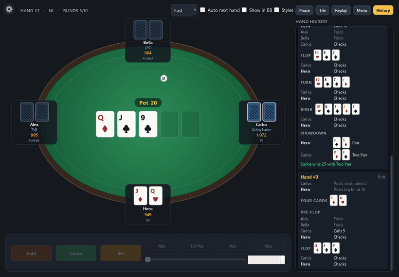

# Poker Engine

Moteur de session **Texas Hold'em No-Limit** développé en Python.

L'objectif de ce projet est de construire progressivement un moteur de poker fiable et extensible, capable de gérer une session complète de plusieurs mains, depuis la distribution des cartes jusqu'à la détermination du ou des gagnants et à la redistribution des pots.

> 🎬 **Voir l'application en action : [DEMO.md](DEMO.md)**, avec des captures d'écran et des animations de chaque mode et outil.
>
> 📜 **Licence :** [PolyForm Noncommercial 1.0.0](LICENSE.md). Toute utilisation commerciale est interdite.

<p align="center">
  <a href="DEMO.md"></a>
</p>

---

# Sommaire

* [Alpha - 1.0](#alpha---10)

    * [Fonctionnalités](#fonctionnalités)

* [Déroulement d'une main](#déroulement-dune-main)

* [Gestion de l'ordre de parole](#gestion-de-lordre-de-parole)

* [Gestion des all-ins](#gestion-des-all-ins)

* [Évaluation des mains](#évaluation-des-mains)

* [Main pots et side pots](#main-pots-et-side-pots)

* [Split Pots](#split-pots)

* [Conservation des jetons](#conservation-des-jetons)

* [Architecture](#architecture)

* [Session](#session)

* [Interface actuelle](#interface-actuelle)

* [Alpha 1.1 — Robustesse et tests](#alpha-11--robustesse-et-tests)

* [Alpha 1.2 — Historique et observabilité](#alpha-12--historique-et-observabilité)

* [Alpha 1.3 — Abstraction des joueurs](#alpha-13--abstraction-des-joueurs)
* [Alpha 2.0 — Application de bureau](#alpha-20--application-de-bureau)

* [Limites restantes de la Alpha - 1.x](#limites-restantes-de-la-alpha---1x)

* [Beta 1.0 — Simulation](#beta-10--simulation)

* [Beta 1.1 — Performance](#beta-11--performance)

* [V1.0 — Tournois](#v10--tournois)

* [V1.0.1 — Confort de jeu](#v101--confort-de-jeu)

* [V1.1 — Outils](#v11--outils)

* [V1.1.1 — Outils améliorés](#v111--outils-améliorés)

* [V1.2 — Réglages et sons](#v12--réglages-et-sons)

* [V1.3 — Multi-tabling et tables pleines](#v13--multi-tabling-et-tables-pleines)

* [V1.4 — Historique et mosaïque](#v14--historique-et-mosaïque)

* [V2.0 — IA, stratégies et guide](#v20--ia-stratégies-et-guide)
* [V2.1 — Vos données, replay à la table](#v21--vos-données-replay-à-la-table)
* [V2.x — Améliorations de l'IA](#v2x--améliorations-de-lia)

* [V3.0 — Extras cash game](#v30--extras-cash-game)
* [V3.1 — Tournois multi-tables](#v31--tournois-multi-tables)
* [V3.1.1 — Limit Hold'em, tables en direct](#v311--limit-holdem-tables-en-direct)
* [V3.2 — Spin & Go en un clic, styles des bots](#v32--spin--go-en-un-clic-styles-des-bots)

* [Plus tard / peut-être](#plus-tard--peut-être)

* [Principes de développement](#principes-de-développement)

* [Objectif du projet](#objectif-du-projet)

* [Licence](#licence)

---

# Alpha - 1.0

La **Alpha - 1.0** constitue une première version fonctionnelle et robuste du cœur du moteur de poker.

Elle couvre le déroulement d'une session Texas Hold'em avec **2 à 6 joueurs**, incluant les phases de mise, les all-ins, les short all-ins, le showdown, les side pots, les splits et la redistribution automatique des jetons.

## Fonctionnalités

### 👥 Gestion des joueurs & de la table

| Fonctionnalité          | Alpha - 1.0 |
| ----------------------- | :---------: |
| 2–6 joueurs             |      ✅      |
| Positions à la table    |      ✅      |
| Rotation du dealer      |      ✅      |
| Élimination des joueurs |      ✅      |
| Sessions multi-hands    |      ✅      |

### 🃏 Gestion des mains

| Fonctionnalité                     | Alpha - 1.0 |
| ---------------------------------- | :---------: |
| Small Blind / Big Blind            |      ✅      |
| Distribution des cartes privatives |      ✅      |
| Flop / Turn / River                |      ✅      |
| Gestion du board communautaire     |      ✅      |
| All-in                             |      ✅      |
| Short all-in                       |      ✅      |
| Auto-runout                        |      ✅      |

### 💰 Système de mise

| Fonctionnalité                              | Alpha - 1.0 |
| ------------------------------------------- | :---------: |
| Fold                                        |      ✅      |
| Check                                       |      ✅      |
| Call                                        |      ✅      |
| Raise                                       |      ✅      |
| Re-raise                                    |      ✅      |
| All-in directement                          |      ✅      |
| Short all-in                                |      ✅      |
| Minimum raise                               |      ✅      |
| Ordre de parole circulaire                  |      ✅      |
| Reprise correcte de l'action après un raise |      ✅      |
| Reopening après un re-raise                 |      ✅      |
| Gestion du dernier joueur ayant agi         |      ✅      |

Le moteur respecte l'ordre de parole du Texas Hold'em et ne redémarre pas arbitrairement l'action au début de la liste des joueurs après un raise.

Les règles de reopening sont également prises en compte lorsqu'un joueur effectue un all-in constituant ou non une raise complète.

### 🏆 Évaluation des mains

| Fonctionnalité                                     | Alpha - 1.0 |
| -------------------------------------------------- | :---------: |
| Évaluation des meilleures combinaisons de 5 cartes |      ✅      |
| 9 catégories de mains                              |      ✅      |
| Comparaison des kickers                            |      ✅      |
| Comparaison des mains                              |      ✅      |
| Détection des égalités                             |      ✅      |
| Ace-low straight                                   |      ✅      |
| Ace-low straight flush                             |      ✅      |

Les rankings de mains implémentés en Alpha - 1.0 sont :

1. High Card

2. Pair

3. Two Pair

4. Three of a Kind

5. Straight

6. Flush

7. Full House

8. Four of a Kind

9. Straight Flush

### 🏦 Gestion des pots

| Fonctionnalité                                           | Alpha - 1.0 |
| -------------------------------------------------------- | :---------: |
| Main pot                                                 |      ✅      |
| Side pots                                                |      ✅      |
| Side pots multiples                                      |      ✅      |
| Prise en compte des contributions des joueurs ayant fold |      ✅      |
| Éligibilité des joueurs aux différents pots              |      ✅      |
| All-in players au showdown                               |      ✅      |
| Split pot                                                |      ✅      |
| Gestion des jetons indivisibles                          |      ✅      |
| Distribution automatique des gains                       |      ✅      |
| Vérification de la cohérence du pot                      |      ✅      |

Les contributions de chaque joueur sont conservées pendant toute la main afin de permettre la reconstruction des différents pots.

### 🔄 Déroulement d'une session

| Fonctionnalité                                      | Alpha - 1.0 |
| --------------------------------------------------- | :---------: |
| Enchaînement des hands                              |      ✅      |
| Gestion de la fin d'une hand                        |      ✅      |
| Showdown automatique                                |      ✅      |
| Attribution des pots                                |      ✅      |
| Rotation du dealer                                  |      ✅      |
| Élimination automatique des joueurs sans jetons     |      ✅      |
| Arrêt de la session lorsqu'il ne reste qu'un joueur |      ✅      |

[↑ Retour au sommaire](#sommaire)

---

# Déroulement d'une main

Une main suit le cycle général suivant :

```text

Nouvelle main

    │

    ├── Attribution des positions

    │

    ├── Small Blind / Big Blind

    │

    ├── Distribution des cartes privées

    │

    ▼

 PREFLOP

    │

    ├── Betting round

    │

    ├── Fold ?

    │     └── Oui → joueur restant gagne

    │

    ├── Tous les joueurs encore en jeu sont all-in ?

    │     └── Oui → Auto-runout

    │

    ▼

  FLOP

    │

    ├── Betting round

    │

    ├── Auto-runout si nécessaire

    │

    ▼

  TURN

    │

    ├── Betting round

    │

    ├── Auto-runout si nécessaire

    │

    ▼

  RIVER

    │

    ├── Betting round

    │

    ▼

 SHOWDOWN

    │

    ├── Évaluation des mains

    │

    ├── Construction des pots

    │

    ├── Détermination des gagnants

    │

    ├── Gestion des splits

    │

    └── Distribution des pots

    │

    ▼

Fin de la main

    │

    └── Rotation du dealer

```

[↑ Retour au sommaire](#sommaire)

---

# Gestion de l'ordre de parole

Le moteur conserve l'état nécessaire pour maintenir un ordre de parole circulaire cohérent.

Lorsqu'un joueur effectue un raise, l'action est rouverte pour les autres joueurs encore capables d'agir.

L'action reprend **immédiatement après le raiser**, et non au début de la liste des joueurs.

Exemple :

```text

Player1

Player2

Player3

Player2 → RAISE

Player3

   ↓

Player1

```

Si Player3 effectue ensuite une sur-relance :

```text

Player2 → RAISE

    ↓

Player3 → RAISE

    ↓

Player1

    ↓

Player2

```

Cette mécanique permet de gérer les séquences de raises et de re-raises sans dépendre de la position des joueurs dans la liste Python.

Le moteur conserve également le dernier joueur ayant agi ainsi que le dernier raiser et la taille du dernier raise lorsque ces informations sont nécessaires au déroulement du betting round.

[↑ Retour au sommaire](#sommaire)

---

# Gestion des all-ins

Un joueur all-in reste **dans la main**, mais ne peut plus effectuer d'action.

Le moteur distingue notamment :

* joueur encore dans la main ;

* joueur capable d'agir ;

* joueur all-in ;

* joueur ayant fold ;

* joueur éliminé.

Un joueur all-in reste éligible au showdown et aux pots pour lesquels il a contribué.

Le moteur gère également les **short all-ins**.

Un short all-in peut augmenter le montant engagé sans nécessairement constituer une raise complète. Dans ce cas, il ne doit pas automatiquement rouvrir l'action aux joueurs ayant déjà agi.

À l'inverse, un all-in constituant une raise complète peut rouvrir l'action.

Ces comportements sont couverts par les tests du moteur.

Si tous les joueurs encore dans la main sont all-in, aucune nouvelle action n'est demandée.

Le moteur effectue automatiquement le reste du board.

### Exemple

Si tous les joueurs sont all-in préflop :

```text

PREFLOP

   ↓

ALL-IN

   ↓

FLOP

   ↓

TURN

   ↓

RIVER

   ↓

SHOWDOWN

```

Si les joueurs sont all-in au flop :

```text

FLOP

   ↓

ALL-IN

   ↓

TURN

   ↓

RIVER

   ↓

SHOWDOWN

```

[↑ Retour au sommaire](#sommaire)

---

# Évaluation des mains

Le moteur évalue la meilleure combinaison possible de cinq cartes parmi :

* les 2 cartes privées du joueur ;

* les cartes communes disponibles.

Les catégories supportées sont :

1. High Card

2. Pair

3. Two Pair

4. Three of a Kind

5. Straight

6. Flush

7. Full House

8. Four of a Kind

9. Straight Flush

Les égalités sont départagées grâce aux **tiebreakers / kickers**.

Le moteur gère également les cas où plusieurs joueurs possèdent exactement la même meilleure combinaison.

Dans ce cas, le pot est partagé entre les joueurs concernés.

[↑ Retour au sommaire](#sommaire)

---

# Main pots et side pots

Les contributions de chaque joueur sont conservées pendant toute la main.

Le moteur peut ainsi reconstruire les différents pots à partir des contributions totales.

### Exemple

```text

Player1 : 100

Player2 : 300

Player3 : 500

```

Le moteur construit :

```text

Main Pot

100 × 3

= 300


Side Pot #1

(300 - 100) × 2

= 400


Side Pot #2

(500 - 300) × 1

= 200

```

Chaque pot possède son propre ensemble de joueurs éligibles.

Un joueur ayant fold peut avoir contribué à un pot, mais **ne peut jamais gagner ce pot**.

Les joueurs all-in restent éligibles aux pots correspondant à leur niveau de contribution.

[↑ Retour au sommaire](#sommaire)

---

# Split Pots

Lorsqu'au moins deux joueurs possèdent une main de valeur strictement identique, le pot concerné est partagé entre eux.

Exemple :

```text

Pot = 200

Player1 → meilleure main

Player2 → meilleure main

```

Résultat :

```text

Player1 : +100

Player2 : +100

```

Les éventuels jetons indivisibles sont attribués de manière déterministe selon l'ordre de la table.

[↑ Retour au sommaire](#sommaire)

---

# Conservation des jetons

Le moteur vérifie que les mouvements de jetons restent cohérents pendant le déroulement d'une main.

L'invariant principal est :

```text

Somme des stacks des joueurs

+

pot de la hand

=

nombre total de jetons avant la hand

```

Les contributions des joueurs sont incluses dans le pot et ne doivent donc pas être comptabilisées une seconde fois.

Cette propriété est couverte par des tests dédiés de conservation des jetons.

[↑ Retour au sommaire](#sommaire)

---

# Architecture

Le projet est découpé en trois couches avec un seul sens de dépendance :
l'interface parle à la couche application, la couche application parle au
moteur de poker, et le moteur ne dépend de rien d'autre.

```text
backend/
├── poker_engine/          Règles du Texas Hold'em (sans UI ni bots)
│   ├── constants.py       Types Card, Street, ActionType et Position
│   ├── deck.py            Paquet de 52 cartes
│   ├── models.py          Player, Table, Hand et événements d'historique
│   ├── actions.py         Actions et mouvements de jetons
│   ├── betting.py         Ordre de parole, actions légales, exécution
│   ├── hand.py            Cycle de vie d'une main (début, streets, showdown)
│   ├── hand_evaluator.py  Évaluation et comparaison des mains
│   ├── pots.py            Main pot et side pots
│   ├── showdown.py        Gagnants et distribution des gains
│   ├── history.py         Enregistrement de l'historique
│   ├── blinds.py          BlindLevel (blinds, ante), BlindStructure
│   └── session.py         Configuration de la session, joueurs, niveau
├── application/           Coordination entre moteur, contrôleurs et UI
│   ├── controllers.py     PlayerController, HumanController, DecisionContext
│   ├── game.py            PokerGame : joue une session étape par étape
│   ├── setup.py           Création d'une partie, d'un tournoi, d'un Spin & Go
│   ├── cash_rules.py      Limites de buy-in, recaves et compléments (V3.0)
│   ├── tournament.py      Tournois sur une ou plusieurs tables, recaves, Spin & Go
│   ├── payouts.py         Répartitions des prix, multiplicateurs du Spin & Go
│   ├── structures.py      Structures de blinds par défaut
│   ├── hand_summary.py    Statistiques d'un joueur depuis l'historique
│   ├── action_clock.py    Horloge d'action, time bank, préréglages (V1.0.1)
│   ├── equity.py          Équité après un all-in (V1.0.1), calculateur (V1.1)
│   ├── ranges.py          Mains de départ, notation des ranges, préréglages (V1.1.1)
│   ├── game_modes.py      Cash game, tournoi, Spin & Go
│   ├── bankroll.py        Bankroll, journal, comptes de partie (V1.0.1)
│   ├── profile.py         Fichier de profil : réglages et bankroll
│   ├── persistence.py     Sauvegarde et chargement des sessions (JSON, format 4)
│   ├── hand_records.py    Sessions sauvegardées relues en enregistrements (V1.1)
│   ├── replay.py          Une main enregistrée redistribuée pas à pas (V1.1)
│   └── hand_import.py     Historiques de mains PokerStars et Winamax (V1.1.1)
├── bots/                  Joueurs contrôlés par l'ordinateur
│   ├── random_bot.py      Actions légales aléatoires
│   ├── basic_bot.py       Heuristiques : force de main et cotes du pot
│   ├── profiles.py        BotProfile et les styles de jeu
│   ├── short_stack.py     Jeu en tournoi selon le tapis
│   ├── push_fold.py       Ranges push/fold par profondeur et position
│   ├── preflop_charts.py  Ranges d'ouverture et de réponse par position (V2.0)
│   ├── opponent_model.py  Stats en direct et ranges des adversaires (V2.0)
│   ├── monte_carlo.py     Showdowns aléatoires contre ces ranges (V2.0)
│   ├── strategy_bot.py    Shark et Adaptive : tableaux, ratio M, EV (V2.0)
│   ├── push_fold_solver.py  Push/fold heads-up résolu par CFR+ (V2.0)
│   ├── three_handed_solver.py  Push/fold à trois par CFR Monte Carlo (V2.x)
│   ├── push_fold_solutions.py  Leurs solutions, générées (V2.x)
│   └── factory.py         Création d'un bot depuis son nom (nit, tag, lag…)
└── simulation/            Simulations de bots sans interface (Beta 1.0)
    ├── config.py          SimulationConfig, SeatSpec, StackPolicy, seeds
    ├── table.py           ArenaTable : des bots jouent étape par étape
    ├── runner.py          Batches, politiques de tapis, workers, replay
    ├── events.py          Observateur notifié à chaque étape d'une main
    ├── stats.py           Statistiques fusionnables (joueurs, Engine Lab)
    ├── invariants.py      Contrôles des jetons après chaque main
    ├── result.py          SimulationResult, export JSON et CSV
    ├── summary.py         Lecture en langage clair d'un résultat
    ├── matchup.py         Matrice de matchups heads-up et balayage de paramètre
    ├── engine_lab.py      Fréquences à 7 cartes comparées à la théorie
    ├── bench.py           Benchmark mono-cœur (Beta 1.1)
    ├── tournament_runner.py  Séries de tournois et de Spin & Go (V1.0)
    ├── tournament_stats.py   Places, ITM et ROI
    ├── my_stats.py        Statistiques du joueur depuis ses sessions (V1.1)
    └── cli.py             python -m backend.simulation …

frontend/
├── main.py                Point d'entrée de l'application PySide6
├── terminal_ui.py         Interface terminal
├── theme.py               Couleurs et feuille de style
├── formatting.py          Textes des cartes, montants (jetons ou BB), actions
├── runout.py              Cartes retournées et équité après un all-in payé
├── modes.py               Modes affichés par le menu principal
├── guide.py               Le contenu du Guide (V2.0)
├── sounds.py              Effets sonores et leur lecteur (V1.2)
├── sound_synthesis.py     Fabrique les fichiers son (python -m frontend.sound_synthesis)
├── assets/sounds/         Les effets sonores (WAV)
├── ui/
│   ├── navigation_window.py  Pile de navigation (Retour fonctionne partout), bouton ⚙
│   ├── main_window.py     Le lobby : menu, outils, Bot Arena, réglages, tables
│   ├── game_window.py     Une partie dans sa propre fenêtre (V1.3)
│   ├── settings_dialog.py La fenêtre des réglages (V1.2)
│   ├── guide_window.py    Le Guide : application, styles de bots, vocabulaire (V2.0)
│   ├── replayer_window.py Le relecteur à côté d'une table (V2.1)
│   ├── tournament_lobby.py, bot_manager_dialog.py  Lobby et bots (V3.1)
│   ├── table_spectator_window.py  Regarder une autre table (V3.1.1)
│   ├── spin_quick_screen.py  Spin & Go en un clic (V3.2)
│   ├── main_menu_screen.py, bankroll_screen.py         Menu et bankroll
│   ├── cash_setup_screen.py, game_screen.py            Cash game
│   ├── tournament_setup_screen.py, tournament_screen.py,
│   │   tournament_results_screen.py         Tournoi et Spin & Go
│   ├── arena_setup_screen.py, arena_progress_screen.py,
│   │   arena_results_screen.py, arena_watch_screen.py  Bot Arena
│   └── tools_screen.py, replayer_screen.py, equity_screen.py,
│       my_stats_screen.py, session_browser_screen.py   Outils (V1.1)
└── components/            Carte, siège, table, panneau d'actions, graphiques,
                           choix de l'horloge, ligne buy-in et bankroll,
                           sélecteur de cartes, grille des ranges, barre de
                           bankroll, bouton des réglages, choix des bots et
                           historique des mains (V1.4)

tests/                     Tests moteur, application, bots, simulation et UI
```

Le moteur est piloté **une étape à la fois**, ce qui laisse la main à
l'interface entre deux étapes (une interface graphique ne bloque jamais) :

```python
hand = start_hand(session)  # blinds, cartes privées, tour préflop

while not hand.finished:
    if hand.current_player is None:
        advance_hand(hand)  # street suivante, ou showdown
    else:
        apply_action(hand, action)  # validée par get_legal_actions()
```

`PokerGame` (couche application) encapsule cette boucle : chaque `game.step()`
demande sa décision au contrôleur du joueur qui doit parler — un bot ou
l'humain — et l'exécute, ou distribue la street suivante.

Dans le moteur, les responsabilités restent séparées :

```text
BETTING          « Qui parle ensuite, et que peut-il faire ? »
   ▼
HAND EVALUATOR   « Quelle est la valeur de sa main ? »
   ▼
SHOWDOWN         « Qui gagne chaque pot ? »
   ▼
POTS             « Combien reçoit chaque joueur ? »
```

[↑ Retour au sommaire](#sommaire)

---

# Session

Une session peut contenir plusieurs mains.

Le dealer tourne entre les joueurs encore en possession de jetons.

La session continue tant qu'au moins deux joueurs disposent encore de jetons.

Lorsqu'un joueur n'a plus de jetons après une main, il peut être éliminé de la session.

La session se termine lorsqu'il ne reste plus qu'un joueur possédant des jetons.

Le dealer est déterminé par un index correspondant à l'ordre de création des joueurs.

Par exemple :

```python
session = make_session(alice, bob, charlie)

session.table.dealer_index = 0
```

signifie que **Alice est au bouton**.

La rotation du dealer s'effectue ensuite dans le sens horaire en ignorant les joueurs ne pouvant plus participer à la session.

[↑ Retour au sommaire](#sommaire)

---

# Interface actuelle

L'application est une **application de bureau PySide6**. Elle s'ouvre sur un
**menu principal** qui liste les modes : **Cash Game**, **Tournoi**,
**Spin & Go**, **Bot Arena** et **Tools** (les outils). Le Cash Game, le
Tournoi et le Spin & Go s'ouvrent chacun dans **leur propre fenêtre**, pour
jouer plusieurs parties à la fois (multi-tabling, voir
[V1.3](#v13--multi-tabling-et-tables-pleines)). Le menu et les écrans de
réglage des modes payants affichent votre **bankroll** et ouvrent l'écran
**Bankroll**. Chaque écran a un bouton Retour, et le bouton **⚙** en haut à
gauche ouvre les **réglages** (votre nom, les sons, les options des tables)
depuis n'importe quelle fenêtre, voir [V1.2](#v12--réglages-et-sons).

```bash
uv sync                        # installe les dépendances
uv run python -m frontend.main # lance l'application de bureau
```

**Cash Game** — un joueur humain contre 1 à 8 bots, du heads-up à la table
pleine :

- **Réglages** : nombre d'adversaires et style de jeu de chaque bot, tapis de
  départ (le buy-in, payé par la bankroll), blinds et horloge d'action ; vous
  jouez sous le nom choisi dans les réglages.
- **Table** : sièges, cartes privées, cartes communes, mises, pot et bouton
  dealer ; **Show in BB** affiche tous les montants en big blinds. Une fois un
  all-in payé, les cartes sont retournées avec les chances de gain de chacun.
- **Panneau d'actions** : seules les actions que le moteur déclare légales sont
  actives, avec un curseur et des raccourcis (Min, 1/2 Pot, Pot, Max) pour
  choisir le montant d'une mise ou d'une relance, et l'**horloge d'action**
  avec sa time bank ; **Pause** la fige.
- **Historique** : chaque main de la session dans son propre bloc, les
  cartes dessinées et les actions colorées par type ; le bouton **History**
  l'affiche ou le masque, voir [V1.4](#v14--historique-et-mosaïque).
- **Effets sonores** pour les cartes, les jetons et chaque action, et les
  **cartes des bots** montrées au showdown, à la fin de chaque main ou
  toujours, selon les réglages.
- **Entre deux mains** : la main suivante démarre seule une fois le
  résultat affiché (**Auto next hand**, désactivable), ou recave quand le
  joueur n'a plus de jetons. Un choix **Speed** (Slow, Normal, Fast, Turbo)
  règle la vitesse des bots et de la main suivante. Quitter la table rend
  votre tapis à la bankroll.

Voir la [V1.0.1](#v101--confort-de-jeu) pour l'affichage en BB, les cartes
retournées après un all-in, l'horloge d'action et la bankroll.

**Tournoi** et **Spin & Go** — vous contre des bots, avec des blinds qui
montent, voir [V1.0](#v10--tournois).

**Bot Arena** — des bots contre des bots (tables cash, tournois et Spin & Go),
voir [Beta 1.0](#beta-10--simulation) et [V1.0](#v10--tournois).

**Guide** — le bouton **Guide** du menu principal explique l'application,
chaque style de bot (et comment le battre) et le vocabulaire du poker ; le
**?** à côté des styles de jeu l'ouvre sur les bots, voir
[V2.0](#v20--ia-stratégies-et-guide).

**Tools** (outils) — le relecteur de mains, le calculateur d'équité, vos
statistiques et le navigateur de sessions, voir [V1.1](#v11--outils) ; les
cartes choisies à la souris, les ranges et les historiques PokerStars et
Winamax, voir [V1.1.1](#v111--outils-améliorés).

Une interface terminal minimale, basée sur la même couche application, reste
disponible :

```bash
uv run python -m frontend.terminal_ui
```

[↑ Retour au sommaire](#sommaire)

---

# Alpha 1.1 — Robustesse et tests

La **Alpha 1.1** est dédiée à la robustesse du moteur et à sa couverture de tests.

## Tests

Le cœur du moteur dispose actuellement d'une suite de tests automatisés couvrant les principales règles du Texas Hold'em.

Les tests couvrent notamment :

```text

Hand evaluator

    ├── 9 catégories de mains

    ├── Kickers

    ├── Straights

    ├── Ace-low

    └── Comparaison

Betting

    ├── Fold

    ├── Check

    ├── Call

    ├── Raise

    ├── Re-raise

    ├── Ordre de parole

    └── Reopening

All-ins

    ├── Full all-in

    ├── Short all-in

    ├── Minimum raise

    └── Reopening

Pots

    ├── Main pot

    ├── Side pots

    ├── Multiple side pots

    └── Eligibility

Showdown

    ├── Best hand

    ├── Fold resolution

    ├── Split pots

    └── Pot accounting

Session

    ├── Dealer rotation

    └── Eliminations

Chip integrity

    └── Conservation des jetons

```

État actuel de la suite (la suite complète, voir aussi
[V3.1.1](#v311--limit-holdem-tables-en-direct)) :

```text
1906 passed
```

### État actuel

* [x] Tests unitaires complets de l'évaluateur

* [x] Tests des side pots

* [x] Tests des splits

* [x] Tests des all-ins

* [x] Tests de l'ordre de parole

* [x] Tests des re-raises

* [x] Tests des éliminations

* [x] Tests de conservation des jetons

* [x] Gestion des short all-ins

* [x] Validation des actions utilisateur

* [x] Vérification de l'intégrité du pot

* [x] Gestion correcte de la reprise de l'action après un raise

* [x] Rotation du dealer

### Tests d'intégration

Des tests d'intégration couvrent désormais des mains et des sessions complètes :

* [x] Main complète jusqu'au showdown
* [x] Main terminée par un fold
* [x] Main avec all-in et run-out automatique
* [x] Main avec side pot
* [x] Plusieurs mains consécutives
* [x] Rotation du dealer entre plusieurs mains
* [x] Conservation des jetons sur une session complète

### Tests de stress

Les principaux scénarios d'intégration sont aussi exécutés de nombreuses fois
pour détecter des états incohérents ou un comportement non déterministe :

```text
Main complète         → 100 exécutions
Main terminée par fold → 100 exécutions
All-in et run-out     → 100 exécutions
Side pot              → 100 exécutions
Plusieurs mains       → 100 exécutions
Raise / re-raise      → 100 exécutions
```

Objectif :

> Garantir qu'une session complète de Texas Hold'em puisse être exécutée sans produire d'état de jeu ou financier incohérent, y compris lors d'exécutions répétées des scénarios critiques.

[↑ Retour au sommaire](#sommaire)

---

# Alpha 1.2 — Historique et observabilité

**Alpha 1.2 est terminée.**

Le moteur conserve désormais un historique structuré de chaque main terminée et persiste l'historique complet de la session dans un fichier `.dat`.

Exemple :

```text

Hand #42

PREFLOP

Player1 → POST SB 5

Player2 → POST BB 10

Player3 → CALL 10

Player1 → RAISE 30

Player2 → CALL 20

Player3 → FOLD

FLOP

...

SHOWDOWN

...

PAYOUT

...
```

Fonctionnalités implémentées :

* [x] `ActionEvent`

* [x] Historique des actions

* [x] Historique des streets

* [x] Historique des pots

* [x] Historique des payouts

* [x] Identification du joueur ayant initié chaque bet

* [x] Historique de session contenant les mains terminées

* [x] Sauvegarde de la session dans un fichier `.dat`

* [x] Tests de persistence

Les données sauvegardées contiennent les informations nécessaires pour reconstruire le déroulement d'une main et constituent la base du relecteur de mains ([V1.1](#v11--outils)).

[↑ Retour au sommaire](#sommaire)

# Alpha 1.3 — Abstraction des joueurs

✅ **Terminée.** Le moteur de poker est entièrement découplé de toute interface.

```text
PlayerController            choose_action(DecisionContext) -> Action
       │
       ├── HumanController  l'interface transmet la décision de l'utilisateur
       │
       ├── RandomBot        actions légales aléatoires
       │
       └── BasicBot         heuristiques, paramétrées par un BotProfile
                            (Nit, TAG, LAG, Calling Station, Maniac…)
```

L'application demande *« Quelle action doit effectuer Player3 ? »* sans savoir
si la réponse vient de l'interface de bureau, du terminal ou d'un bot. Un
contrôleur ne reçoit qu'un `DecisionContext` : ses propres cartes et l'état
public de la main (tapis, mises, board, historique public des actions), jamais
les cartes des adversaires.

* [x] `PlayerController`
* [x] `HumanController`
* [x] Contrôleurs de bots (`RandomBot`, `BasicBot` et ses profils)
* [x] `DecisionContext` sans information cachée

[↑ Retour au sommaire](#sommaire)

---

# Alpha 2.0 — Application de bureau

La **Alpha 2.0** transforme le moteur en application de bureau jouable.

## Ce qui a changé

- **Moteur piloté pas à pas** : le moteur n'interroge plus le terminal. Il
  expose `start_hand`, `get_legal_actions`, `apply_action` et `advance_hand`,
  et peut jouer une main complète sans aucune interface.
- **Couche application** : `PokerGame` coordonne le moteur et les contrôleurs
  des joueurs, sauvegarde la session après chaque main et élimine les bots
  qui n'ont plus de jetons.
- **Bots** : `RandomBot` (actions légales aléatoires) et `BasicBot` (force de
  main, cotes du pot, bluffs occasionnels). Les bots ne reçoivent qu'un
  `DecisionContext`, qui ne contient jamais les cartes des adversaires.
- **Interface PySide6** : menu, table, panneau d'actions et historique.
- **Structure du projet** : `backend/poker_engine`, `backend/application`,
  `backend/bots` et `frontend`.

## Corrections de règles

- Un **all-in court** au-dessus de la mise en cours devient le montant à
  payer. Les joueurs ayant déjà parlé peuvent seulement payer ou se coucher ;
  ceux qui n'ont pas encore parlé, ou qui font face au total à au moins une
  relance complète, peuvent encore relancer.
- La **mise d'ouverture minimale** est la big blind.
- Une **big blind incomplète** impose toujours de payer une big blind entière.
- Un joueur **à tapis sur sa blind** reçoit bien ses cartes.
- Les **all-ins sont enregistrés** dans l'historique de la main.
- La relance n'est pas proposée quand **aucun adversaire ne peut répondre**.
- Les joueurs sans jetons ne **reçoivent pas de cartes** et ne peuvent plus
  influencer une main.

## Outils

```bash
uv run pytest            # tests
uv run ruff check .      # lint
uv run ruff format .     # formatage
uv run pyright           # analyse statique
```

[↑ Retour au sommaire](#sommaire)

---

# Limites restantes de la Alpha - 1.x

Certaines fonctionnalités restent volontairement exclues de cette première version.

L'objectif est de stabiliser le cœur du moteur avant d'ajouter des mécaniques plus avancées.

## Antes

✅ Antes classiques et big-blind antes depuis la [V1.0](#v10--tournois).

## Straddle

Les straddles ne sont pas supportés.

## Betting Cap

Le moteur ne possède pas encore de limite configurable sur le nombre de raises par street.
(Ajoutée en V3.1.1, avec le Pot Limit et le Fixed Limit.)

## Tournament Blinds

✅ Structures de blinds avec niveaux par nombre de mains ou par temps depuis
la [V1.0](#v10--tournois). Les cash games gardent des blinds fixes.

## Rebuy

Partiellement supporté. En cash game, un joueur humain sans jetons peut
recaver le tapis de départ entre deux mains ; les bots sans jetons sont
éliminés. La Bot Arena a une politique de recave automatique. Les tournois
ont des recaves optionnelles pendant les premiers niveaux et un add-on
([V1.0](#v10--tournois)).

## Cash-game Rebuy

Partiellement supporté : un joueur sans jetons peut recaver, mais un joueur
qui a encore des jetons ne peut pas compléter son tapis.

## Action abstraite pour les bots

✅ Résolu en Alpha 1.3 / 2.0 : le moteur est piloté pas à pas et l'application
demande chaque décision à un `PlayerController` (interface de bureau, bot, ou
toute future IA ou API). Voir [Alpha 1.3](#alpha-13--abstraction-des-joueurs).

## Historique complet des actions

Un historique structuré est désormais disponible pour chaque main terminée.

Le moteur conserve notamment :

* chaque action des joueurs, y compris les blinds ;

* l'ordre des actions et la street ;

* la position du joueur ;

* l'état de la mise avant et après l'action ;

* l'état du pot après l'action ;

* l'identification des joueurs ayant initié les bets ;

* les cartes communes de chaque street ;

* les résultats des pots et les payouts ;

* les évaluations du showdown.

Les mains terminées sont conservées dans l'historique de la session et persistées dans un fichier de session `.dat`.

## Event Sourcing

Le moteur n'utilise pas encore une architecture event-sourced.

Les changements d'état sont effectués directement sur les objets `Player`, `Hand` et `Table`.

## Simulation

✅ Disponible depuis la [Beta 1.0](#beta-10--simulation).

## IA

Aucune intelligence artificielle de poker n'est intégrée à la Alpha - 1.x.

[↑ Retour au sommaire](#sommaire)

---

# Beta 1.0 — Simulation

La **Beta 1.0** ajoute un moteur de simulation sans interface, la **Bot
Arena** et le **menu principal**.

## Fonctionnalités

### 🤖 Moteur de simulation (`backend/simulation`)

- Joue des milliers à des millions de mains entre bots, sans interface, en
  pilotant directement le moteur (`start_hand` / `get_legal_actions` /
  `apply_action` / `advance_hand`). Rien n'est écrit sur le disque sauf
  demande.
- **Reproductible** : le paquet et chaque bot tirent leurs nombres de
  générateurs initialisés par une seed. Le budget est découpé en batches de
  taille fixe dont la seed dérive de `(seed, index du batch)` : la même
  configuration et la même seed donnent des **résultats identiques au bit
  près, quel que soit le nombre de workers**. Une simulation sans seed en
  tire une et l'indique.
- **Parallèle** : un pool `multiprocessing` exécute les batches, avec
  progression et annulation.
- **Politiques de tapis** :
  - `reset` : chacun commence chaque main avec le tapis de départ (par
    défaut, et la façon la plus propre de comparer des bots) ;
  - `rebuy` : les joueurs sans jetons sont recavés et les recaves comptées.
    Les tapis ne se conservent qu'à l'intérieur d'un batch : chaque batch
    repart de tapis neufs, et le bouton de départ tourne d'un batch au
    suivant ;
  - `elimination` : le budget est un nombre de sessions complètes, jouées
    jusqu'à ce qu'un joueur ait tous les jetons. Une session qui atteint
    `max_hands_per_session` (5000 par défaut) classe les survivants par tapis
    et est signalée comme plafonnée.
- **Invariants** : la conservation des jetons est vérifiée après chaque main.
  Un échec arrête la simulation avec la seed et l'index de la main, et
  `replay_hand()` rejoue exactement cette main.
- **Mode duplicate** (politique reset uniquement) : chaque donne est jouée une
  fois par rotation circulaire des sièges, donc chaque bot joue chaque donne
  depuis chaque siège.

### 📊 Statistiques

Toutes les statistiques sont fusionnables : les résultats des workers se
combinent exactement.

- **Par joueur** : mains, jetons nets, **bb/100** avec son écart-type et son
  **intervalle de confiance à 95 %**, **VPIP**, **PFR**, **3-bet %**,
  **facteur d'agression** et fréquence, **WTSD**, **W$SD**, c-bet et fold to
  c-bet, fréquences d'actions par street, résultats par position, recaves et
  places finales (% de victoires, place moyenne).
- **Graphique des jetons** : jetons nets cumulés, réduit à 300 points au
  plus.
- **Engine Lab** : catégories de mains au showdown, split pots, side pots par
  main, fréquences d'all-in et de run-out automatique, mains par seconde, et
  une vérification de l'évaluateur contre les fréquences théoriques des
  catégories à 7 cartes.
- **Export** : JSON (tout, configuration et seed comprises) et CSV (une ligne
  par joueur).

### 🎭 Styles de jeu

`BasicBot` est paramétré par un `BotProfile` (seuils de force de main, cotes
du pot, probabilités de mise et de bluff, c-bets, tailles de mise). Le profil
par défaut est exactement le `BasicBot` de l'Alpha 2.0, et le « niveau des
bots » du cash game garde son comportement.

| Bot             | Style                              |
| --------------- | ---------------------------------- |
| Nit             | Très serré et passif               |
| TAG             | Serré-agressif                     |
| LAG             | Large-agressif                     |
| Calling Station | Large-passif, se couche rarement   |
| Maniac          | Très large, très agressif          |
| Basic           | Le bot heuristique de l'Alpha 2.0  |
| Random          | Actions légales aléatoires         |

### 🏟️ Bot Arena

- **Réglages** : 2 à 6 sièges (style et nom optionnel), tables prédéfinies
  comme *TAG vs 3 Maniacs* ou *Full styles table (6-max)*, mains, blinds,
  tapis de départ, politique de tapis, seed, workers et mode duplicate.
- **Mode rapide** : simule en arrière-plan avec une barre de progression, la
  vitesse, le temps restant et Annuler, puis affiche les **résultats** :
  classement triable, graphique des jetons, résumé en langage clair basé sur
  les intervalles de confiance, onglet *Avancé* (fréquences d'actions,
  résultats par position, Engine Lab, seed et configuration), export JSON /
  CSV et *Relancer (même seed)*.
- **Mode spectateur** : les mêmes mains qu'une simulation rapide de la
  configuration, jouées sur la table à vitesse réglable (lent / normal /
  rapide, pause, pas à pas), avec l'historique et une vue optionnelle des
  cartes de tous les joueurs.

> 📸 *Emplacement de capture d'écran : résultats de la Bot Arena.*

## Ligne de commande

```bash
# Une table de bots : affiche un tableau de synthèse et exporte JSON + CSV
uv run python -m backend.simulation run --seats tag,maniac,maniac,maniac --hands 100000 --seed 42

# Sessions à élimination, ou mode duplicate
uv run python -m backend.simulation run --seats nit,tag,lag --policy elimination --sessions 500
uv run python -m backend.simulation run --seats tag,lag --hands 100000 --duplicate

# Matrice de matchups heads-up, et balayage d'un paramètre
uv run python -m backend.simulation matchup --bots nit,tag,lag,station,maniac --hands 20000
uv run python -m backend.simulation sweep --bot tag --param bluff_probability --values 0,0.1,0.2,0.3 --field station,maniac

# Validation du moteur, et liste des bots
uv run python -m backend.simulation engine-lab --samples 500000
uv run python -m backend.simulation bots
```

Options communes : `--hands`, `--sessions`, `--blinds 5/10`, `--stack`,
`--policy reset|rebuy|elimination`, `--seed`, `--workers`, `--batch-size`,
`--max-hands-per-session`, `--duplicate`, `--history`, `--no-invariants`,
`--output DIR` et `--no-export`. Les exports vont par défaut dans
`backend/data/simulations/` (ignoré par git).

## Changement dans le moteur

L'évaluateur calcule désormais directement la meilleure main de 7 cartes au
lieu de comparer les 21 combinaisons de 5 cartes : environ **12× plus
rapide**, avec exactement les mêmes résultats, vérifiés contre l'ancien
algorithme (conservé sous le nom `evaluate_best_of_combinations`). Aucune
règle de poker n'a changé.

## Objectifs

* [x] Jouer automatiquement des milliers de mains
* [x] Mesurer les statistiques
* [x] Calculer les fréquences d'actions
* [x] Tester la distribution des mains
* [x] Tester statistiquement l'équité (fréquences des catégories à 7 cartes)
* [x] Tester la fréquence des splits
* [x] Tester les side pots
* [x] Benchmark du moteur

## Tests

```text
1102 passed
```

[↑ Retour au sommaire](#sommaire)

---

# Beta 1.1 — Performance

La **Beta 1.1** accélère le simulateur **sans changer un seul résultat** : la
même seed joue toujours exactement les mêmes cartes, actions et gains.

## Filet de sécurité

- Des **tests golden** (`tests/simulation/test_golden.py`) figent six
  simulations avec seed (6 BasicBots, la table des 6 styles avec historique,
  heads-up, mode duplicate, recave automatique, élimination). Chacune a deux
  empreintes : un hash de chaque main (cartes, board, actions, pots, gains,
  tapis) et un hash du résultat exporté. Elles ont été enregistrées avant
  toute optimisation et n'ont pas changé depuis.
- **Benchmark** : des tables fixes avec seed jouées sur un cœur, avec les
  contrôles par défaut (invariants actifs, sans historique).

```bash
uv run python -m backend.simulation bench --hands 20000 --repeat 3
```

`--repeat` joue chaque table plusieurs fois et garde la plus rapide, ce qui
filtre le bruit du reste de la machine.

## Résultats

Mains par seconde sur un cœur, meilleure de trois séries de 20 000 mains,
mesurées en alternance sur la même machine :

| Table               | Beta 1.0 | Beta 1.1 | Gain  |
| ------------------- | -------: | -------: | ----: |
| 6 BasicBots         |    1 070 |    1 500 | ×1,40 |
| Table des 6 styles  |      775 |    1 190 | ×1,54 |
| Heads-up TAG vs LAG |    3 704 |    5 084 | ×1,37 |

## Optimisations

- **Actions légales calculées une seule fois par décision** : elles sont
  mises en cache sur la main (`betting.get_current_legal_actions`), avec pour
  clé toutes les valeurs dont elles dépendent, et partagées entre le contexte
  de décision et `apply_action`.
- **Contexte de décision moins coûteux** : `PlayerView` et `DecisionContext`
  sont des named tuples immuables, plusieurs fois moins chers à construire que
  des dataclasses gelées.
- **Historique moins coûteux** : l'historique du pot est déduit des actions,
  qui enregistrent déjà le pot après chacune d'elles.
- **Lecture des mains plus rapide pour les bots** : `evaluate_rank` donne la
  catégorie et les départages sans choisir les cinq cartes, une table carte →
  rang remplace l'analyse de chaque carte, et les fonctions de force des bots
  (fonctions pures des cartes) sont mises en cache.
- **Micro-coûts du moteur** : constantes partagées pour fold et check, moins
  de parcours des sièges pour trouver le prochain joueur.

## Ce qui reste

L'objectif d'environ 2 000 mains/s sur 6 BasicBots **n'est pas atteint**
(environ 1 500 sur cette machine). Il ne reste plus de point chaud unique : le
temps restant est réparti dans le modèle d'état en Python pur.

- **Le mélange du paquet** (~6 %) ne peut pas changer : il faut tirer les
  mêmes nombres aléatoires pour garder chaque résultat identique.
- **Les événements** : `ActionEvent` reste une dataclass gelée (~4 %), car
  c'est le format persisté de l'historique.
- **Le reste** se répartit entre la logique des mises, les heuristiques des
  bots et les collecteurs de statistiques, quelques pourcents chacun. Aller
  plus loin demanderait une autre représentation de l'état (des tableaux au
  lieu d'objets joueurs), c'est-à-dire une refonte du moteur plutôt qu'une
  optimisation.

Les workers parallèles continuent de passer à l'échelle avec le nombre de
cœurs.

[↑ Retour au sommaire](#sommaire)

---

# V1.0 — Tournois

La **V1.0** ajoute les **tournois** à une table, le **Spin & Go**, les
**antes**, des bots qui tiennent compte de leur tapis, et les tournois dans
la Bot Arena.

## Fonctionnalités

### ⏫ Blinds et antes (moteur)

- `BlindLevel` (small blind, big blind, ante, type d'ante) et `BlindStructure`
  (niveaux ordonnés). Les niveaux montent **par nombre de mains** (toujours en
  simulation et dans les tests, entièrement déterministe) ou **par temps**
  quand vous jouez : le temps est mesuré par l'application, jamais par le
  moteur, et un niveau ne change qu'entre deux mains. Après le dernier niveau,
  le jeu reste au dernier niveau.
- **Antes classiques** (chaque joueur paie) et **big-blind antes** (la big
  blind paie une ante pour toute la table).
- Les antes sont enregistrées dans l'historique (`post_ante`), affichées dans
  l'historique et dans le pot.

### 🏆 Tournois

- 2 à 6 joueurs, tapis de départ, structure de blinds, buy-in (monnaie
  fictive), répartition des prix, recaves et add-on optionnels.
- Joués **jusqu'à ce qu'un joueur ait tous les jetons**, avec les places
  finales, les prix, la main où chaque joueur a été éliminé, le nombre de
  mains et le niveau atteint.
- **Répartitions prédéfinies** : le gagnant prend tout, 65 / 35, 50 / 30 / 20.
  Par défaut : le gagnant prend tout à 2–3 joueurs, 65 / 35 à 4–6. Les prix
  sont des unités entières ; les restes d'arrondi vont aux meilleures places.
- **Recaves** pendant les 3 premiers niveaux, au tapis de départ ou en
  dessous, puis un **add-on** ; chacun ajoute un buy-in au prize pool et à la
  mise du joueur. Les bots recavent dès qu'ils le peuvent et prennent
  l'add-on au tapis de départ ou en dessous.

### 🎰 Spin & Go

- 3 joueurs, structure hyper-turbo, 500 jetons (25 big
  blinds au premier niveau).
- Un **multiplicateur de prix** est tiré dans une table configurable *avant*
  la première main, avec le générateur aléatoire à seed ; le prize pool vaut
  ce nombre de buy-ins. Le gagnant prend tout, 80 / 10 / 10 à partir de ×100.

### 🧠 Bots en tapis court

En tournoi, les bots mesurent leur **tapis effectif en big blinds** (le plus
petit entre leur tapis et le plus gros tapis adverse encore dans la main) :

- **Push/fold** à 12 big blinds ou moins (13 pour le LAG, 15 pour le Maniac) :
  tapis ou fold d'entrée, call des tapis adverses, selon des **ranges par
  profondeur de tapis et par position** (`backend/bots/push_fold.py`). Jamais
  de petite relance.
- **Tapis court** jusqu'à 25 big blinds : ouvertures à 2,2 big blinds,
  relances à tapis, call d'une relance seulement avec une main forte.
- Une relance qui engage 40 % du tapis devient un tapis.
- Chaque profil garde son style en élargissant ou en resserrant les ranges de
  base. À 8 big blinds au bouton : Nit 23 %, Calling Station 31 %, TAG 35 %,
  Basic 39 %, LAG 48 %, Maniac 65 % des mains jouées à tapis.
- Les cash games ne changent pas : les résultats golden de la Beta 1.0 sont
  toujours valables.

Les 169 mains de départ sont classées par équité à tapis contre une main
aléatoire, calculée avec l'évaluateur du projet (Monte Carlo) ; les
pourcentages sont des approximations simplifiées des tableaux push/fold de
Nash en 6-max.

### 🏟️ Bot Arena : tournois

- Types de séries **Tournoi** et **Spin & Go** à côté des séries cash. Le
  budget est un nombre de tournois ; les batches contiennent des tournois
  complets, chacun avec sa seed `(seed, index du tournoi)`, et une limite de
  mains par tournoi (les tournois plafonnés sont classés au tapis et comptés
  dans les résultats).
- **Équité des sièges** : au tournoi *t*, le bot d'index *i* s'assoit au siège
  *(i + t) mod n*.
- **Statistiques** : % de victoires, ITM %, place moyenne, distribution des
  places, **ROI** = (prix − mise) / mise avec son intervalle de confiance à
  95 %, durée moyenne (mains, niveau). En Spin & Go : les multiplicateurs
  tirés, le ROI qui les inclut, et le **ROI sans le tirage du multiplicateur**
  (chaque partie payant son prize pool espéré), qui compare les bots sur leur
  seul jeu.
- Écran de résultats : histogramme des places, classement par ROI, résumé en
  places et en ROI. Résultats identiques sur 1 et N workers.

### 🖥️ Dans l'application

- **Réglages du tournoi** : votre nom, 1 à 5 adversaires (un style pour tous
  ou un par siège), tapis de départ, structure (Turbo / Regular / Deep),
  vitesse des niveaux (par mains ou par temps), buy-in, répartition, recaves
  et add-on.
- **Réglages du Spin & Go** : votre nom, 2 adversaires, buy-in, vitesse des
  niveaux et table de multiplicateurs ; une courte **révélation du
  multiplicateur** affiche le prize pool avant la première main.
- **À la table** : niveau actuel et suivant avec les mains ou le temps
  restants, joueurs restants, votre place, tapis moyen en big blinds, prize
  pool ; courtes notifications d'élimination avec la place et le prix ;
  propositions de recave et d'add-on ; **Pause** fige l'horloge des niveaux
  et la table.
- **Quand vous êtes éliminé** : votre place et votre prix, puis **Regarder**
  (la table continue à vitesse réglable), **Passer aux résultats** (la suite
  est jouée instantanément, avec les mêmes mains qu'en regardant) ou
  **Retour au menu**.
- **Résultats** : classement final avec les prix et la main où chaque joueur
  est sorti, vos statistiques (mains, VPIP / PFR, showdowns, tapis, plus gros
  pot), **Rejouer** et **Retour au menu**. Le fichier de session est
  sauvegardé avec les résultats du tournoi.

> 📸 *Emplacement de capture d'écran : table de tournoi et révélation du Spin & Go.*

## Choix de règles

- **Les antes sont de l'argent mort** : elles vont au pot, mais ne comptent
  jamais dans le montant à payer ni dans la taille d'une relance.
- **Ordre de paiement avec un tapis court** :
  - ante classique : **l'ante d'abord, puis la blind**. Un joueur qui ne peut
    pas couvrir l'ante paie ce qu'il a et est à tapis ; il reçoit quand même
    ses cartes et peut gagner ce que chaque autre joueur a égalé de son ante ;
  - big-blind ante : **la blind d'abord, puis l'ante** (règle TDA). L'ante va
    dans le **main pot**, que chaque joueur servi peut gagner, même quand la
    big blind est à tapis pour moins ou se couche.
- **Argent mort au-dessus de tous les joueurs restants** : les jetons mis
  uniquement par des joueurs couchés, au-dessus de la contribution de chaque
  joueur encore en jeu, rejoignent le plus haut pot encore gagnable.
- **Éliminations simultanées** : le joueur qui avait le plus de jetons au
  début de la main finit mieux classé. Des tapis exactement égaux partagent
  la meilleure place de leur groupe et se répartissent les prix des places
  qu'ils couvrent ; une unité indivisible va au premier d'entre eux dans le
  sens horaire à partir de la gauche du bouton.
- **Bouton mobile, sans bouton mort** : avant chaque main, le bouton passe au
  joueur suivant qui a des jetons. Quand la table passe de 3 à 2 joueurs, les
  règles du heads-up s'appliquent : le bouton paie la small blind, parle en
  premier préflop et en dernier après le flop.
- **Niveaux par temps** : l'horloge continue pendant qu'un joueur réfléchit
  ou est inactif ; seule la Pause explicite la fige.

## Structures de blinds

Les tournois commencent avec 1500 jetons. Turbo,
Regular et Deep partagent leurs niveaux et diffèrent par leur rythme :
**Turbo** 6 mains / 3 min, **Regular** 10 mains / 6 min, **Deep** 15 mains / 10 min. Une big-blind ante égale à la big blind commence au niveau 4 (des
antes classiques d'un dixième de la big blind sont disponibles avec
`with_classic_antes`). Toutes les structures sont dans
`backend/application/structures.py`.

| Niveau | Blinds | Ante |
| -----: | -----: | ---: |
| 1 | 10 / 20 | — |
| 2 | 15 / 30 | — |
| 3 | 25 / 50 | — |
| 4 | 50 / 100 | 100 (big blind) |
| 5 | 75 / 150 | 150 (big blind) |
| 6 | 100 / 200 | 200 (big blind) |
| 7 | 150 / 300 | 300 (big blind) |
| 8 | 200 / 400 | 400 (big blind) |
| 9 | 300 / 600 | 600 (big blind) |
| 10 | 400 / 800 | 800 (big blind) |
| 11 | 500 / 1000 | 1000 (big blind) |
| 12 | 750 / 1500 | 1500 (big blind) |
| 13 | 1000 / 2000 | 2000 (big blind) |

**Spin & Go hyper-turbo** (5 mains ou
2 minutes par niveau, 500 jetons) :

| Niveau | Blinds | Ante |
| -----: | -----: | ---: |
| 1 | 10 / 20 | — |
| 2 | 15 / 30 | — |
| 3 | 20 / 40 | — |
| 4 | 25 / 50 | 50 (big blind) |
| 5 | 30 / 60 | 60 (big blind) |
| 6 | 40 / 80 | 80 (big blind) |
| 7 | 50 / 100 | 100 (big blind) |
| 8 | 60 / 120 | 120 (big blind) |
| 9 | 80 / 160 | 160 (big blind) |
| 10 | 100 / 200 | 200 (big blind) |
| 11 | 150 / 300 | 300 (big blind) |
| 12 | 200 / 400 | 400 (big blind) |

## Multiplicateurs du Spin & Go

La table par défaut est **équitable** : le prize pool espéré vaut exactement
les trois buy-ins payés. Les probabilités sont exactes (poids entiers sur
10 000).

| Multiplicateur | Prize pool | Probabilité | Répartition |
| ---: | ---: | ---: | --- |
| ×2 | 2 buy-ins | 53,00% | Le gagnant prend tout |
| ×3 | 3 buy-ins | 39,00% | Le gagnant prend tout |
| ×5 | 5 buy-ins | 6,00% | Le gagnant prend tout |
| ×10 | 10 buy-ins | 1,80% | Le gagnant prend tout |
| ×100 | 100 buy-ins | 0,19% | 80 / 10 / 10 |
| ×1000 | 1000 buy-ins | 0,01% | 80 / 10 / 10 |
| **Espérance** | **3 buy-ins** | | |

La table **Realistic (~7 % de rake)** est proche des sites réels :

| Multiplicateur | Prize pool | Probabilité | Répartition |
| ---: | ---: | ---: | --- |
| ×2 | 2 buy-ins | 75,00% | Le gagnant prend tout |
| ×3 | 3 buy-ins | 17,00% | Le gagnant prend tout |
| ×5 | 5 buy-ins | 6,00% | Le gagnant prend tout |
| ×10 | 10 buy-ins | 1,80% | Le gagnant prend tout |
| ×100 | 100 buy-ins | 0,19% | 80 / 10 / 10 |
| ×1000 | 1000 buy-ins | 0,01% | 80 / 10 / 10 |
| **Espérance** | **2,78 buy-ins** | | |

## Ligne de commande

```bash
# 1 000 tournois entre six styles, avec recaves et une répartition 50/30/20
uv run python -m backend.simulation tournament --seats nit,tag,lag,station,maniac,basic \
    --tournaments 1000 --structure turbo --payout 50-30-20 --rebuys

# 1 000 Spin & Go, avec la table de multiplicateurs réaliste
uv run python -m backend.simulation spin --seats tag,lag,maniac --tournaments 1000 \
    --multipliers realistic
```

Options : `--seats`, `--tournaments`, `--structure turbo|regular|deep`,
`--payout wta|65-35|50-30-20`, `--rebuys`, `--multipliers fair|realistic`,
`--stack`, `--buy-in`, `--seed`, `--workers`, `--batch-size` (tournois par
batch), `--max-hands-per-tournament`, `--no-invariants`, `--output` et
`--no-export`. Un contrôle des jetons a lieu après chaque main ; un échec
indique le tournoi et la main à rejouer avec `replay_tournament()`.

## Fichiers de session

Les fichiers de session sont désormais au **format version 2** : le niveau de
blinds de la session et de chaque main, la big-blind ante de chaque main
(`dead_money`), et les résultats du tournoi. `load_session_file()` lit les
versions 1 et 2 (un fichier version 1 est mis à jour en mémoire) et refuse les
versions inconnues avec un message clair.

## Changements dans le moteur

- Antes (`post_ante`, `Hand.dead_money`) et niveau de blinds d'une session.
- Le constructeur de pots fusionne les jetons mis uniquement par des joueurs
  couchés, au-dessus de tous les joueurs restants, dans le plus haut pot
  encore disputé (avec une big-blind ante couchée, cela levait l'erreur
  « A pot has no eligible players »).
- Aucune autre règle n'a changé ; les résultats golden du cash game sont
  inchangés.

## Objectifs

Moteur et application :

* [x] Niveaux de blinds (par mains ou par temps) avec structures configurables
* [x] Antes (y compris big-blind ante)
* [x] Suivi des éliminations et places finales
* [x] Répartitions des prix (prize pool, places payées)
* [x] Add-on et recave en tournoi (optionnels selon la structure)

Modes :

* [x] Mode tournoi (une table, 2 à 6 joueurs)
* [x] Spin & Go : 3 joueurs, structure hyper-turbo, multiplicateur aléatoire

Bots et simulation :

* [x] Jeu en tapis court (push/fold selon le tapis en big blinds)
* [x] Tournois dans la Bot Arena (% de victoires, ROI, place moyenne)

## Tests

```text
1309 passed
```

[↑ Retour au sommaire](#sommaire)

---

# V1.0.1 — Confort de jeu

La **V1.0.1** est une petite mise à jour avant la V1.1 : les montants en
**big blinds**, les cartes **retournées dès qu'aucune mise n'est plus
possible**, une **horloge d'action** avec **time bank**, et une **bankroll**
persistante. Aucune règle de poker n'a changé : les résultats de référence
(golden tests) du cash game et des tournois, et tous les résultats de la Bot
Arena, sont identiques, et les simulations sans interface n'utilisent rien
de tout cela.

## Fonctionnalités

### 🔢 Montants en big blinds

- Une case **Show in BB** sur toutes les tables : cash game, tournoi,
  Spin & Go et mode Watch de la Bot Arena. C'est un seul réglage pour toutes,
  mémorisé d'un lancement à l'autre.
- En big blinds : les tapis, les mises, le pot, le statut « Wins … », le
  montant à suivre, les libellés de relance, la case du montant et ses
  raccourcis (Min, 1/2 Pot, Pot, Max). Une décimale au plus : `42.5 BB`,
  `20 BB`. En tournoi, la big blind du niveau de la main (un nouveau niveau
  s'affiche dès la main suivante) ; le tapis moyen était déjà en big blinds.
- **Affichage seulement** : le moteur et toutes les actions restent en
  jetons. Un montant tapé en big blinds devient le nombre de jetons le plus
  proche dans les limites légales ; la valeur la plus haute de la case est
  exactement le tapis.
- L'**historique reste en jetons** : c'est le relevé de la main, et un
  journal ne mélange jamais deux unités.

### 👀 Cartes retournées après un all-in payé

- **Quand** : dès que les mises sont terminées pour le reste de la main,
  c'est-à-dire quand au moins deux joueurs sont encore dans le coup et
  qu'**au plus un d'entre eux peut agir, sans rien à suivre** : tout le monde
  est all-in, ou le seul joueur qui a encore des jetons a payé le dernier
  all-in. Le moteur connaît ce moment (c'est là qu'il commence à distribuer
  les streets sans décision) : `is_betting_closed(hand)` l'indique, et le
  moteur enregistre l'action après laquelle il est arrivé dans
  `Hand.revealed_after_action`. L'interface ne recalcule jamais la règle.
- **À l'écran** : les cartes de tous les joueurs encore dans le coup sont
  retournées d'un coup (« *** Cards revealed *** » dans l'historique), puis
  chaque street restante est distribuée à environ **1 s** d'intervalle
  (1,25 pas normal), puis vient le showdown habituel avec le paiement.
- **% de gain** sous les cartes de chaque joueur pendant la distribution :
  **exact** à partir du flop (tous les boards possibles sont comptés), et
  une **estimation « ≈ 38% »** avant le flop (environ 1,7 million de boards :
  un échantillon plafonné à environ 4 000 évaluations de mains, à peu près
  40 ms, pour que la table ne se fige jamais). L'estimation utilise son
  propre générateur aléatoire, initialisé à partir des cartes sur la table :
  le générateur de la partie et du paquet n'est jamais touché. Seules les
  cartes visibles sont connues ; les cartes couchées comptent comme
  inconnues. Le code (`backend/application/equity.py`) fait aussi
  tourner le calculateur d'équité de la V1.1.
- Pareil en **mode Watch de la Bot Arena** (avec « Show all cards »
  décoché) et quand vous **regardez la suite d'un tournoi après avoir été
  éliminé**.
- Aucune fuite d'information : rien n'est montré tant qu'un joueur peut
  encore agir.

### ⏱️ Horloge d'action et time bank

Comme sur les sites de poker en ligne, chacune de vos décisions a un **temps
pour agir**, affiché par une barre qui se vide (orange pendant les 5
dernières secondes). Quand il est écoulé, une **time bank** démarre
automatiquement (en bleu, « Time bank 34 s »). La time bank est partagée par
toute la session ou tout le tournoi, se recharge lentement, et le temps pour
agir non utilisé ne s'y ajoute pas.

| Préréglage | Temps pour agir | Time bank de départ | Recharge |
| --- | ---: | ---: | --- |
| Off | — | — | — |
| Relaxed | 30 s | 120 s | +10 s toutes les 25 mains, max 120 s |
| Standard | 20 s | 60 s | +10 s toutes les 25 mains, max 120 s |
| Fast | 15 s | 30 s | +5 s toutes les 25 mains, max 60 s |
| Hyper | 10 s | 20 s | +5 s toutes les 25 mains, max 40 s |

- **Par défaut** : Cash Game → Standard, Tournoi → Standard (Fast pour la
  structure Turbo), Spin & Go → Fast. Chaque écran de réglages propose un
  choix **Action clock**, dont **Off** ; votre choix est mémorisé pour chaque
  mode. Les préréglages sont dans `backend/application/action_clock.py`.
- **Temps écoulé** : quand les deux sont épuisés, la main est morte : vous
  **checkez** si c'est gratuit, sinon vous vous **couchez** (le comportement
  habituel en ligne). L'action est enregistrée comme hors délai dans
  l'historique (`Hand.timed_out_actions`) et affichée « Hero ran out of time
  — folds ».
- **Pause** fige l'horloge d'action et la time bank, et les relance
  exactement où elles en étaient. Elle fige aussi les bots, les niveaux au
  temps et la main suivante ; le bouton Pause est présent sur toutes les
  tables où vous jouez.
- Les bots n'ont pas d'horloge. Les simulations sans interface, les
  résultats de la Bot Arena et « Skip to results » ne l'utilisent jamais. Le
  temps est mesuré dans la couche application (`ActionClock`, avec une
  source de temps que les tests remplacent) ; le moteur ignore tout du temps.

### ⏩ Vitesse de la table et main suivante automatique

- **Auto next hand** (activé par défaut) : une fois une main terminée, son
  résultat reste affiché un moment, puis la main suivante est distribuée
  seule ; le bouton **Next hand** la distribue tout de suite. La table vous
  attend quand vous avez un choix à faire : une recave quand vous n'avez
  plus de jetons, ou l'add-on d'un tournoi.
- **Speed**, choisie à la table : le temps que met un bot pour agir et la
  durée d'affichage du résultat. La valeur par défaut, Normal, est proche des
  clients en ligne comme PokerStars ou Winamax (environ une seconde par
  action, environ trois secondes entre deux mains). Le board d'un all-in
  arrive un peu plus lentement qu'une action. Les préréglages sont dans
  `frontend/pacing.py`.

| Vitesse | Action d'un bot / street | Résultat affiché avant la main suivante |
| --- | ---: | ---: |
| Slow | 1,5 s | 5 s |
| **Normal** (par défaut) | 0,9 s | 3 s |
| Fast | 0,45 s | 1,5 s |
| Turbo | 0,15 s | 0,6 s |

- Un seul réglage pour les tables de cash game, de tournoi et de Spin & Go
  (utilisé aussi quand vous regardez la fin d'un tournoi après votre
  élimination), mémorisé d'un lancement à l'autre. Le mode Watch de la Bot
  Arena garde son propre choix de vitesse.

### 💰 Bankroll

Une bankroll hors ligne dans une **monnaie fictive** (il n'y a d'argent réel
nulle part dans l'application), qui démarre à **100 000**. Une unité vaut un
jeton.

| Mode | Payé par la bankroll | Crédité à la bankroll |
| --- | --- | --- |
| Cash game | le tapis de départ, au début de la session ; chaque recave | votre tapis quand vous quittez la table |
| Tournoi | le buy-in au départ ; chaque recave et l'add-on | votre prix, à la fin du tournoi |
| Spin & Go | le buy-in au départ | votre prix, à la fin (gros multiplicateurs compris) |
| Bot Arena | — | — |

- **Buy-ins prédéfinis**, pour des enjeux comparables d'un mode à l'autre :
  tournois 100 / 500 / 1 000 / 5 000 / 10 000, Spin & Go 100 / 500 / 1 000 /
  5 000 (1 000 par défaut pour les deux) ; les montants libres et les
  **freerolls à 0** restent possibles. Les préréglages sont dans
  `backend/application/setup.py`. La Bot Arena et la ligne de commande
  gardent leurs propres valeurs par défaut (100 et 10) : sinon leurs
  résultats exportés changeraient, et le ROI ne dépend pas du montant du
  buy-in.
- **Pas assez d'argent** : chaque écran de réglages affiche le buy-in et
  votre bankroll ; un mode que vous ne pouvez pas payer ne peut pas être
  lancé (Play est désactivé, avec un message). Les recaves et add-ons que
  vous ne pouvez pas payer ne sont pas proposés.
- **Conseil de bankroll** (désactivable depuis l'écran Bankroll) : un
  avertissement discret quand un buy-in représente une grosse part de la
  bankroll, selon les règles habituelles : environ **20 buy-ins** en cash
  game, **50** en tournoi et en Spin & Go (`RECOMMENDED_BUY_INS`). Il ne
  bloque jamais.
- **Recharge** : sous **1 000** (`RELOAD_THRESHOLD`), le menu principal
  propose de revenir à 100 000.
- **Écran Bankroll** : le solde, le résultat net global et par mode, un
  **graphique** de la bankroll dans le temps, et le **journal** (date et
  heure, type, mode, montant, solde après, description ; le plus récent en
  premier, filtrable par mode). **Set bankroll…** et **Reset to 100,000**
  sont enregistrés comme **ajustements**, pour que l'historique reste
  honnête ; les ajustements ne comptent jamais comme des résultats.

> 📸 *Emplacement de capture d'écran : les cartes retournées avec le % de
> gain, l'horloge d'action dans la time bank, et l'écran Bankroll.*

## Quitter ou fermer pendant une partie

- **Cash game** : votre **tapis restant** (les jetons qui ne sont pas dans
  le pot) est sauvegardé au début de chaque main, après chacune de vos
  actions et après chaque main. Quitter la table ou l'application le rend à
  la bankroll. Si l'application se ferme de façon inattendue, il est rendu
  au lancement suivant, avec une ligne au journal et un message qui le dit.
  Les jetons déjà dans le pot sont perdus, comme sur un fold.
- **Tournoi et Spin & Go** : quitter alors que vous êtes encore en jeu
  demande une confirmation, puis vous fait **abandonner** le tournoi (le
  buy-in est perdu, et une ligne « Forfeit » est enregistrée). Une fois
  éliminé, quitter joue instantanément la fin du tournoi (les mêmes mains
  qu'en le regardant), pour que votre prix soit connu et crédité. Fermer
  l'application pendant un tournoi le fait aussi abandonner (enregistré au
  lancement suivant).
- Le prix est crédité à la fin du tournoi, pas à votre élimination : les
  bots peuvent encore se recaver et faire grossir le prize pool.

## Profil utilisateur

Les réglages (affichage en BB, horloge par mode, conseils de bankroll) et la
bankroll (solde, journal, partie en cours) sont sauvegardés dans
`profile.json`, dans le dossier de données d'application du système :

| Système | Emplacement |
| --- | --- |
| Windows | `%APPDATA%\Poker\profile.json` |
| macOS | `~/Library/Application Support/Poker/profile.json` |
| Linux | `~/.local/share/Poker/profile.json` |

Depuis les sources ; une application empaquetée utilise son propre dossier
`PokerApp` (voir [V3.2](#v32--spin--go-en-un-clic-styles-des-bots)).

Le fichier a un `format_version`. Chaque sauvegarde écrit un fichier
temporaire, garde la version précédente dans `profile.bak`, puis renomme le
nouveau fichier à sa place. Un fichier abîmé est restauré depuis la
sauvegarde ; le fichier abîmé est mis de côté
(`profile.damaged_<date>.json`) et vous êtes prévenu au lancement.
L'application ne plante jamais sur un profil illisible et ne perd jamais le
solde en silence. Les tests utilisent un dossier temporaire, jamais votre
profil.

## Fichiers de session

Les fichiers de session passent au **format 3** : chaque main enregistre
aussi `revealed_after_action` (l'action après laquelle les cartes ont été
retournées, null sinon) et `timed_out_actions` (les actions décidées par
l'horloge). `load_session_file()` lit les versions 1 à 3. Ces deux champs
rejoignent `ADDED_HISTORY_FIELDS` dans les golden tests, donc les empreintes
de référence restent exactement les mêmes ; des tests séparés vérifient
qu'ils sont enregistrés au bon moment.

## Changements du moteur

- `is_betting_closed(hand)` et `Hand.revealed_after_action`, renseigné par
  le moteur quand les mises se terminent ; `Hand.timed_out_actions`, rempli
  par l'application. Rien d'autre n'a changé dans le moteur, et le benchmark
  est inchangé (1 623 / 1 210 / 5 120 mains par seconde).

## Objectifs

* [x] Montants en big blinds sur toutes les tables, mémorisés
* [x] Cartes retournées dès qu'aucune mise n'est plus possible, streets une par une, % de gain
* [x] Horloge d'action et time bank, délais dépassés enregistrés, Pause les fige
* [x] Bankroll persistante dans les trois modes : consulter, modifier, réinitialiser, recharger
* [x] Time bank pour le joueur humain (déplacée depuis la V1.2)
* [x] Main suivante automatique et vitesse de la table choisie à la table

## Tests

```text
1421 passed
```

[↑ Retour au sommaire](#sommaire)

---

# V1.1 — Outils

La **V1.1** ouvre la carte **Tools** du menu principal : quatre outils pour
étudier vos parties, un **relecteur de mains**, un **calculateur
d'équité**, **Mes stats** et un **navigateur de sessions**. Aucune règle de
poker n'a changé : les résultats de référence (golden tests) et tous les
résultats de la Bot Arena sont identiques.

## Fonctionnalités

### ▶ Relecteur de mains

- **Tools → Hand Replayer** ouvre la **dernière main de votre dernière
  session** ; le navigateur de sessions ouvre n'importe quelle autre main.
- La main est **redistribuée par le moteur** : les joueurs s'assoient avec
  les tapis qu'ils avaient, le paquet est préparé avec les cartes
  enregistrées, et chaque décision enregistrée est rejouée avec
  `apply_action`. La table montre exactement ce qu'elle montrait pendant la
  partie (vos cartes, les mises, le pot, les cartes retournées après un
  all-in avec le % de gain de chacun, le showdown), et le moteur vérifie
  l'enregistrement : une relecture qui ne se termine pas avec les gains
  enregistrés est refusée (`backend/application/replay.py`).
- **Pas à pas** : une décision, ou une street distribuée, comme à la table.
  Boutons **|◀ ◀ Play ▶ ▶|** (clavier : Début, Gauche, Espace, Droite, Fin),
  les vitesses de la table pour Play, et **◀ Hand / Hand ▶** (Page précédente
  / Page suivante) pour parcourir la session. L'historique suit le pas ; les
  délais dépassés sont signalés « (ran out of time) ».
- **Show all cards** montre aussi les cartes que personne n'a vues ; **Show
  in BB** est le réglage commun à toutes les tables.
- Les mains sauvegardées **avant la V1.1** ne peuvent pas être relues :
  leurs cartes privées n'étaient pas enregistrées main par main (voir le
  [format 4](#sessions-sauvegardées--format-4)). Leur historique est affiché
  en texte à la place.

### % Calculateur d'équité

- 2 à 6 mains, chacune de deux cartes (`AsKd`, `A♠ K♦`, `10h 9h`) ou **vide
  pour une main aléatoire**, sur un board de 0 à 5 cartes.
- **Exact** quand toutes les mains sont connues et qu'il y a au plus 50 000
  boards possibles (toujours à partir du flop : 990 boards en heads-up).
  Sinon **Monte Carlo** : 60 000 boards aléatoires, avec une **marge
  d'erreur à 95 %** sur chaque équité (environ ±0,4 %).
- Pour chaque main : son **équité** (une égalité compte comme une part du
  pot), son **% de victoire** et son **% d'égalité**.
- Le calcul avance par petites étapes sur un minuteur (environ 40 ms
  chacune) : l'écran reste réactif, les chiffres s'affinent au fil du
  calcul, et **Stop** l'arrête. Les boards aléatoires viennent d'un
  générateur aléatoire qui lui est propre.
- Le % de gain après un all-in de la V1.0.1 utilise désormais le même
  calculateur, avec exactement les mêmes chiffres (vérifié sur 300
  situations aléatoires avant et après le changement).

| Exemple | Équité |
| --- | ---: |
| A♥ A♦ contre K♣ K♠ sur 2♣ 7♦ 9♥ (exact, 990 boards) | 91,6 % / 8,4 % |
| A♥ A♦ contre K♣ K♠ avant le flop (estimation) | environ 82 % / 18 % |
| A♠ A♦ contre une main aléatoire (estimation) | environ 85 % / 15 % |

### ≡ Mes stats

- Vos statistiques sur **toutes les sessions sauvegardées**, pour tous les
  modes ou un seul : sessions, mains, et **VPIP, PFR, 3-bet, facteur et
  fréquence d'agression, flops vus, WTSD, W$SD, c-bet et fold to c-bet**,
  chacune avec ce qui a été compté (« 22 / 107 ») et ce qu'elle mesure.
- Calculées par les **collecteurs de la Bot Arena** (`StatsCollector`, Beta
  1.0) : chaque main sauvegardée est reconstruite depuis son enregistrement
  et leur est transmise (`backend/simulation/my_stats.py`), donc un VPIP veut
  dire la même chose dans Mes stats et dans la Bot Arena. Un test joue des
  simulations à graine fixe et vérifie que les statistiques reconstruites
  depuis les mains sauvegardées sont égales à celles du jeu en direct, champ
  par champ.
- **Résultats**, séparés par mode : cash games en jetons et en **bb/100**
  avec son intervalle de confiance à 95 % (chaque main compte dans ses
  propres big blinds, donc des sessions à des enjeux différents
  s'additionnent), et **par position** ; tournois et Spin & Go : joués,
  gagnés, dans l'argent, bénéfice et ROI, les tournois non terminés étant
  comptés à part.
- Les fichiers sauvegardés avant la V1.1 comptent aussi : ces statistiques
  n'ont besoin que des actions, du board et des gains, que tous les formats
  enregistrent.

### ▤ Navigateur de sessions

- Chaque partie jouée est sauvegardée (`backend/data/sessions/`). Le
  navigateur liste les sessions, la plus récente en premier, pour tous les
  modes ou un seul : date, mode, mains, résultat (jetons gagnés ou perdus,
  ou « 2nd of 6 (+1 500) ») et mains relisibles.
- Une session affiche un résumé, le **graphique des jetons** (vos gains main
  après main) et **toutes les mains** : blinds, votre position et vos
  cartes, le board, votre résultat et le pot, triables. **Replay hand** (ou
  un double-clic) ouvre le relecteur sur cette main.
- **Open file…** affiche un fichier de session placé n'importe où. Un
  fichier illisible est signalé, jamais bloquant ; un fichier n'est relu que
  s'il a changé.

> 📸 *Emplacement de capture d'écran : l'écran Tools, le relecteur pendant
> la distribution après un all-in, et le navigateur de sessions.*

## Sessions sauvegardées : format 4

Un bug est corrigé : les objets `Player` sont réutilisés d'une main à
l'autre, et chaque sauvegarde réécrivait toutes les mains à partir d'eux.
Les `players` de chaque main (cartes privées, tapis, positions) et son
`dealer` étaient donc en réalité ceux de la dernière main, et les cartes des
mains précédentes étaient perdues.

- Le moteur enregistre maintenant les **sièges** propres à chaque main au
  début de la main (`Hand.seats` : nom, tapis avant les antes et les
  blinds, position, cartes privées), et le dealer d'une main est son
  Bouton.
- Les fichiers de session sont au **format 4** : chaque main enregistre ses
  `seats`, la session le joueur humain (`human`) et le mode (`mode` : cash,
  tournament ou spin). `load_session_file()` lit les versions 1 à 4.
- Les anciens fichiers fonctionnent partout sauf dans le relecteur :
  l'humain est le premier siège (l'application place toujours l'humain en
  premier), le mode est déduit (résultats de tournoi avec un
  multiplicateur : Spin & Go ; résultats ou blinds qui montent : tournoi ;
  sinon un cash game), et le dealer de chaque main est lu à sa position de
  Bouton.
- `seats` rejoint les `ADDED_HISTORY_FIELDS` des golden tests : les
  empreintes de référence restent exactement les mêmes.

## Changements du moteur

- `SeatRecord` et `Hand.seats`, enregistrés par `start_hand`.
- `Deck.stacked(cards)` : un paquet qui distribue d'abord les cartes données
  (relecteur).
- Rien d'autre n'a changé dans le moteur. Le benchmark est inchangé, aux
  variations de mesure près : lancés l'un après l'autre sur la même machine,
  1 654 / 1 217 / 5 139 mains par seconde contre 1 747 / 1 212 / 4 641 pour
  la V1.0.1.

## Objectifs

* [x] Relecteur de mains (basé sur l'historique de l'Alpha 1.2)
* [x] Calculateur d'équité (Monte Carlo, mains contre mains / contre aléatoire, n'importe quel board)
* [x] « Mes stats » : les statistiques du joueur humain sur toutes ses sessions (réutilise les collecteurs de la Beta 1.0)
* [x] Navigateur de sessions (sessions sauvegardées, résultats, graphique des jetons)

## Tests

```text
1516 passed
```

[↑ Retour au sommaire](#sommaire)

---

# V1.1.1 — Outils améliorés

La **V1.1.1** améliore les outils de la V1.1 avant la V1.2 : dans le
calculateur d'équité, les cartes se **choisissent à la souris** et un joueur
peut avoir une **range** (peinte sur une grille, tapée, ou prise dans les
préréglages) ; le navigateur de sessions **ouvre les historiques de mains
PokerStars et Winamax** pour le relecteur. Aucune règle de poker n'a
changé : les résultats de référence (golden tests) et tous les résultats de
la Bot Arena sont identiques.

## Fonctionnalités

### 🖱️ Choisir les cartes

- Chaque main et le board sont des emplacements de cartes : cliquez sur un
  emplacement, puis sur une carte du **sélecteur** (les 52 cartes, une ligne
  par couleur). L'emplacement vide suivant est aussitôt sélectionné, donc
  une main se choisit en deux clics.
- Les cartes déjà utilisées sont grisées et ne peuvent pas être choisies deux
  fois ; un clic droit vide un emplacement. Une main laissée vide reste une
  main aléatoire.

### 🎯 Ranges

- Chaque joueur a une **main** (Hand) ou une **range** (Range). Une range se
  peint sur la **grille 13 × 13** (les paires sur la diagonale, les mains
  assorties au-dessus, les dépareillées en dessous ; cliquez sur une main,
  ou faites glisser pour en peindre plusieurs), se tape dans la notation
  habituelle (`QQ+, AKs, A5s-A2s, KTo+, 22-55, K9s-K6s`), ou se prend dans
  les **préréglages**. Le nombre de combinaisons et la part de toutes les
  mains de départ sont affichés (`backend/application/ranges.py`).
- **Préréglages**, des approximations de tableaux courants en cash game
  6-max à 100 BB, comme point de départ à ajuster :

| Préréglage | Combinaisons | Part |
| --- | ---: | ---: |
| UTG open | 234 | 17,6 % |
| HJ open | 318 | 24,0 % |
| CO open | 442 | 33,3 % |
| BTN open | 658 | 49,6 % |
| SB open | 542 | 40,9 % |
| BB vs BTN open — call | 608 | 45,9 % |
| BB vs BTN open — 3-bet | 98 | 7,4 % |
| SB vs BTN open — 3-bet | 140 | 10,6 % |
| BTN vs CO open — 3-bet | 90 | 6,8 % |
| BTN vs CO open — call | 200 | 15,1 % |
| Premium (top 3%) | 34 | 2,6 % |
| Any two | 1 326 | 100 % |

- **Comment une range compte** : chaque combinaison d'une range qui ne
  partage aucune carte avec une autre main ou le board compte autant, comme
  dans les outils d'équité courants. Les cartes retirées sont comptées
  exactement : QQ+ contre AK fait environ 69 %, car avec un AK sorti il ne
  reste que 3 combinaisons d'AA et 3 de KK à côté des 6 de QQ.
- **Exact ou estimé** : chaque combinaison des ranges est comptée avec
  chaque board quand il y a au plus 50 000 donnes (AA contre KK au turn :
  6 × 44 = 264 donnes) ; sinon 60 000 donnes aléatoires, avec la marge
  d'erreur à 95 %. Une main aléatoire est la range de toutes les mains, donc
  une main contre une main aléatoire à la river est désormais exacte aussi.
- Le % de gain affiché aux tables après un all-in est identique au dernier
  chiffre près (300 situations vérifiées avant et après).

### 📥 Historiques de mains PokerStars et Winamax

- **Sessions → Open file…** lit les historiques de mains `.txt` de
  **PokerStars** (une ou plusieurs mains par fichier) et de **Winamax** (une
  session entière par fichier). Le fichier rejoint la liste des sessions, et
  ses mains s'ouvrent dans le relecteur.
- **Vérifiés par le moteur** (`backend/application/hand_import.py`) : chaque
  main est redistribuée avec les joueurs, les tapis, les cartes et les
  décisions de l'historique, et les blinds et antes, l'ordre de parole,
  chaque montant, le board et les gagnants (avec le rake et les mises non
  payées) doivent être exactement ceux de l'historique. Une main que le
  moteur ne joue pas comme le site l'a jouée est écartée, avec la raison
  (dans le résumé de la session) : un autre jeu que le No Limit Hold'em, le
  run it twice, une blind morte ou manquée, un straddle, un bouton mort.
- **Cartes inconnues** : un historique ne montre que vos cartes et celles
  montrées au showdown. Les autres joueurs reçoivent des cartes que personne
  n'a, qui restent toujours face cachée, même avec « Show all cards » ; un
  joueur qui a jeté ses cartes au showdown reçoit la main la plus faible qui
  reste, donc le gagnant reste le même. Aucun % de gain n'est affiché pendant
  la distribution après un all-in avec une main inconnue.
- **Montants** : les montants en argent réel sont comptés en centimes
  (0,25 € devient 25 ; « Show in BB » donne la lecture habituelle), les
  jetons de tournoi restent des jetons. Les résultats sont avant le rake.
- **Full ring** : jusqu'à 9 joueurs dans la main. Les tables de
  l'application restent de 2 à 6 joueurs.
- Les formats ont été relevés sur des mains d'exemple publiées et des
  analyseurs open source, et sont testés sur des historiques écrits à la main
  pour les deux sites (rake, mise non payée, joueur absent, messages du chat,
  cartes jetées au showdown, noms avec des espaces, main de tournoi à 7
  joueurs avec antes) et sur des mains jouées par le moteur, écrites comme
  PokerStars et Winamax les écrivent, en jetons et en centimes, puis relues à
  l'identique. Les sites changent parfois leurs formats : une main illisible
  est signalée, jamais importée de travers.

> 📸 *Emplacement de capture d'écran : une main contre une range sur la
> grille, et une main PokerStars importée dans le relecteur.*

## Changements du moteur

- Des positions pour 7, 8 et 9 joueurs dans la main (UTG+1, UTG+2 et LJ sont
  ajoutées ; `MAX_HAND_PLAYERS = 9`), pour les historiques full ring. Les
  mains de 2 à 6 joueurs, l'ordre de parole et toutes les règles sont
  inchangés.

## Objectifs

* [x] Cartes choisies à la souris dans le calculateur d'équité
* [x] Ranges : grille, notation et préréglages ; mains et ranges contre des ranges
* [x] Historiques de mains PokerStars et Winamax dans le navigateur de sessions et le relecteur

## Tests

```text
1575 passed
```

[↑ Retour au sommaire](#sommaire)

---

# V1.2 — Réglages et sons

La **V1.2** ajoute une **fenêtre de réglages** accessible depuis chaque
écran, des **effets sonores**, les **cartes des bots** à la demande, et la
**bankroll sur les écrans de réglage** des modes. Aucune règle de poker n'a
changé : le moteur n'est pas touché, les résultats de référence et ceux de la
Bot Arena sont inchangés.

## Fonctionnalités

### ⚙️ Réglages

- Le **bouton ⚙** en haut à gauche de chaque écran (ou **Ctrl+,**) ouvre les
  réglages dans une petite fenêtre au-dessus de l'écran en cours ; la fermer
  ramène à cet écran. À une table où vous jouez, la partie **attend** tant que
  la fenêtre est ouverte (comme avec Pause : l'horloge d'action et celle des
  niveaux s'arrêtent) et reprend à sa fermeture ; une table que vous avez
  mise en pause vous-même reste en pause.
- Chaque changement s'applique aussitôt et est **enregistré dans le
  profil**, comme la bankroll.

| Section | Réglage |
| --- | --- |
| Joueur | **Votre nom** (1 à 12 caractères), utilisé par le Cash Game, le Tournoi et le Spin & Go dès votre prochaine partie ; les écrans de réglage l'affichent |
| Son | **Effets sonores** activés ou non, **volume** (un bruit de jetons permet de l'entendre), un **son quand c'est à vous** |
| Tables | **Cartes des bots** (ci-dessous), **vitesse de la table**, **main suivante automatique**, **montants en big blinds**, **jeu de cartes quatre couleurs** (♦ bleu, ♣ vert, sur toutes les cartes), **conseils de gestion de bankroll** |

- **Restore defaults** remet chaque réglage de la fenêtre à sa valeur par
  défaut, sauf votre nom.
- Speed, Auto next hand et Show in BB restent sur les tables comme
  raccourcis : ce sont les mêmes réglages, la fenêtre et les tables sont
  toujours d'accord.

### 🃏 Les cartes des bots

| Choix | Les cartes des bots sont visibles |
| --- | --- |
| Au showdown seulement (par défaut) | au showdown, ou une fois un all-in payé, comme dans une vraie partie |
| À la fin de chaque main | une fois la main finie, mains couchées comprises (grisées) |
| Toujours | pendant toute la main, pour étudier ou régler les bots |

- **Seul ce que vous voyez change.** Les bots décident toujours avec leurs
  deux cartes et les informations publiques (`DecisionContext`) : un test
  joue des mains avec toutes les cartes visibles à l'écran et vérifie
  qu'aucun bot n'a jamais reçu la carte d'un autre joueur.
- Avec les deux derniers choix, l'historique liste à la fin de la main les
  cartes que personne n'a montrées (« Alex had K♠ Q♦ (folded) »).
- Le relecteur garde son propre interrupteur « Show all cards ».

### 🔊 Effets sonores

| Moment | Son |
| --- | --- |
| Les cartes privées sont distribuées | deux cartes qui glissent |
| Flop, turn, river | une carte retournée |
| Check | deux coups frappés sur la table |
| Fold | des cartes repoussées |
| Call / mise ou relance / all-in | des jetons, davantage pour une relance, une pile pour un all-in |
| Le pot va au gagnant | des jetons balayés sur la table |
| C'est à vous | un carillon discret (désactivable) |
| Tirage du Spin & Go | un tic pour chaque valeur affichée, puis un carillon pour le prix, une fanfare à partir de × 10 |

- Les sons sont **fabriqués par le projet** (`frontend/sound_synthesis.py` :
  bruit filtré pour les cartes, notes brèves et aiguës pour les jetons, note
  grave amortie pour les coups, cloches pour les alertes) : aucun son
  enregistré ni téléchargé. `python -m frontend.sound_synthesis` les réécrit
  dans `frontend/assets/sounds/` (graine fixe, mêmes sons à chaque fois).
- Ils sont joués par `QSoundEffect` de Qt (plusieurs peuvent se superposer :
  un call pendant que le flop est distribué). Les tests n'ouvrent jamais de
  périphérique audio : ils vérifient ce qu'un lecteur muet a reçu.
- Rien n'est joué quand la fin d'un tournoi est jouée instantanément (aller
  aux résultats).

### 💰 La bankroll sur les écrans de réglage

- Les écrans de réglage du **Cash Game**, du **Tournoi** et du **Spin & Go**
  affichent la bankroll en haut à droite, avec le bouton **Bankroll** (et
  **Reload** quand elle est presque vide), comme le menu principal.
- **Retour** depuis l'écran Bankroll ramène à l'écran d'où il a été ouvert
  (l'écran de réglage, ou le menu), avec le solde à jour.

> 📸 *Emplacement de capture d'écran : la fenêtre des réglages au-dessus
> d'une table, avec les cartes des bots visibles et le jeu quatre couleurs.*

## Nouvelle dépendance

- **PySide6-Addons** (la même version de Qt que PySide6-Essentials) pour le
  module multimédia de Qt ; `uv sync` l'installe.
- Pour une version PyInstaller, le dossier des sons doit être copié avec le
  code : `datas=[("frontend/assets/sounds", "frontend/assets/sounds")]` dans
  le fichier `.spec`.

## Changements du moteur

- Aucun.

## Objectifs

* [x] La bankroll et son bouton sur les écrans de réglage du Cash Game, du Tournoi et du Spin & Go ; Retour ramène à l'écran d'où elle a été ouverte
* [x] Les cartes des bots : au showdown, à la fin de la main ou toujours (affichage seulement, les bots ne voient rien de plus)
* [x] Effets sonores : cartes, jetons, chaque action, votre tour, le tirage du Spin & Go
* [x] Une fenêtre de réglages depuis chaque écran, même à une table : votre nom, son et volume, options des tables

## Tests

```text
1631 passed
```

[↑ Retour au sommaire](#sommaire)

---

# V1.3 — Multi-tabling et tables pleines

La **V1.3** permet de jouer **plusieurs parties à la fois**, chacune dans sa
propre fenêtre, comme sur les rooms en ligne (multi-tabling). Elle installe
jusqu'à **neuf joueurs** aux tables du Cash Game et du Tournoi, et donne au
Cash Game le même **choix d'adversaires** que le Tournoi. Dans le moteur,
seule la taille des tables change (6 à 9 sièges) : les résultats golden et
tous les résultats de la Bot Arena de 2 à 6 sièges sont inchangés.

## Fonctionnalités

### 🪟 Multi-tabling

* **Cash Game**, **Tournoi** et **Spin & Go** ouvrent leurs réglages dans une
  **nouvelle fenêtre** ; le menu principal ne change pas et devient le lobby.
  Ouvrez autant de parties que vous voulez, de tous les modes : par exemple
  deux cash games, un tournoi et un Spin & Go en même temps.
* Chaque fenêtre joue sa partie des réglages à la table (et jusqu'aux
  résultats pour un tournoi : Rejouer, ou retour aux réglages). **Retour** sur
  l'écran de réglage ferme la fenêtre. Fermer la fenêtre d'une table encaisse
  un cash game ; un tournoi en cours demande d'abord (il est abandonné).
* **À vous de jouer**, comme sur Winamax :
  * le titre de la fenêtre commence par **« Your turn »**, sa table prend un
    **cadre doré**, et son bouton dans la barre des tâches clignote ;
  * la table qui vous attend **passe au premier plan**, sauf si vous êtes en
    train de décider à une autre table ; dès que vous avez joué, la **table
    suivante** qui vous attend (celle qui attend depuis le plus longtemps)
    passe devant ;
  * le réglage **« Bring the table where it is your turn to the front »**
    (Tables) désactive ce comportement ; la mise en évidence reste.
* **Vos tables** sur le menu principal (dès qu'une table est ouverte) : un
  bouton par table, doré quand elle vous attend, la met au premier plan.
  **Tile** dispose les tables côte à côte sur tout l'écran ; **Cascade** les
  empile, chacune un peu plus bas.
* La fenêtre d'une table peut être **réduite** : quatre tables tiennent côte
  à côte sur un écran full HD. La table, ses sièges et ses cartes
  **rétrécissent** avec la fenêtre, l'historique se masque quand la fenêtre
  est étroite, et les formulaires de réglage défilent.
* **Partagés par toutes les fenêtres :**
  * **La bankroll.** Chaque partie a son propre compte (buy-in, recaves,
    encaissement ou gain), et chaque fenêtre affiche aussitôt le nouveau
    solde.
  * **Les réglages.** Il n'y a qu'une fenêtre de réglages, et toutes les
    tables en cours attendent pendant qu'elle est ouverte.
  * **Les sons.**
  * **Les interrupteurs des tables.** Speed, Auto next hand et Show in BB
    changés à une table s'appliquent à toutes.
* **Quitter** ferme toutes les tables. Un tournoi en cours demande d'abord,
  et y rester annule la fermeture. Si l'application se ferme pendant
  plusieurs parties, chacune est réglée au lancement suivant : les cash
  games sont encaissés, les tournois abandonnés.

### 👥 Tables pleines (9 sièges)

* **Cash Game** et **Tournoi** : **1 à 8 adversaires**, du heads-up au 6-max
  jusqu'à la table pleine. Le Spin & Go reste une partie à trois.
* **Positions** à partir de 7 joueurs : UTG, UTG+1, UTG+2, LJ, HJ, CO, BTN,
  SB, BB. Le moteur les distribuait déjà pour les mains importées d'autres
  sites.
* **Placement des sièges** : ils sont répartis régulièrement le long du
  bord, donc une table large place plus de sièges sur ses grands côtés qu'à
  ses extrémités. À partir de 7 sièges ils sont un peu plus petits, pour que
  neuf sièges ne se chevauchent jamais, même dans une petite fenêtre.
* **Tapis courts** : à une table pleine, les premières positions (UTG+1,
  UTG+2, LJ) font tapis avec la range la plus serrée, celle d'UTG.
* **Répartition des gains** du tournoi par défaut :

| Joueurs | Répartition |
| --- | --- |
| 2 à 3 | Le gagnant prend tout |
| 4 à 6 | 65 / 35 |
| 7 à 9 | 50 / 30 / 20 (nouveau) |

* La **Bot Arena** (tables cash et tournois) et le **calculateur
  d'équité** montent aussi jusqu'à 9 sièges ou mains.
* Trois noms de bots de plus (Gus, Hana, Ivo) : un bot ne prend jamais votre
  nom.

### 🤖 Les adversaires du Cash Game

* Les réglages du Cash Game fonctionnent comme ceux du Tournoi : le **nombre
  d'adversaires** (1 à 8) et **un style de jeu pour chaque bot** : Nit, TAG,
  LAG, Calling Station, Maniac, Basic ou Random. La description de chaque
  style s'affiche en info-bulle, ou cochez **Same style for every bot**.
* Cela remplace l'ancien choix du **niveau des bots**. Normal était le bot
  Basic et Easy le bot Random ; les deux sont toujours dans la liste.
* Par défaut : trois bots, TAG, LAG et Calling Station.

> 📸 *Emplacement de capture d'écran : quatre tables en mosaïque, dont une
> qui vous attend (cadre doré), avec « Vos tables » dans le lobby.*

## Changements du moteur

* `MAX_TABLE_SEATS` : 6 → 9. Il remplace `MAX_HAND_PLAYERS`, qui autorisait
  9 joueurs seulement pour les mains importées ; il n'y a plus qu'une seule
  limite.

## Bankroll et profil

* La bankroll garde une liste de **parties ouvertes** (`open_games`) au lieu
  d'une seule. Les profils enregistrés par une version précédente se lisent
  comme avant.
* Nouveau réglage : `table_to_front` (activé par défaut).

## Objectifs

* [x] Les adversaires du Cash Game choisis comme ceux du Tournoi : nombre de bots, un style pour chacun
* [x] Des tables jusqu'à 9 sièges au Cash Game et au Tournoi (et dans la Bot Arena)
* [x] Multi-tabling : chaque Cash Game, Tournoi et Spin & Go dans sa propre fenêtre, plusieurs à la fois
* [x] Une mécanique à la Winamax : votre tour mis en évidence, la table qui attend au premier plan, la suivante dès que vous avez joué, Tile et Cascade, les tables listées dans le lobby

## Tests

```text
1667 passed
```

[↑ Retour au sommaire](#sommaire)

---

# V1.4 — Historique et mosaïque

La **V1.4** redessine l'**historique des mains** à côté des tables où vous
jouez, pour qu'il se lise d'un coup d'œil (comme sur Winamax), permet de
l'**afficher ou le masquer**, et fait garder à **Tile** la forme de chaque
table. Elle ajoute aussi un bouton **Tile** sur les tables. Aucune règle de
poker ne change.

## Fonctionnalités

### 📜 L'historique des mains

* **Un bloc par main** : son numéro et ses blinds, les blinds postées, **vos
  cartes**, puis chaque street (**Pre-flop**, **Flop**, **Turn**, **River**)
  avec **le board dessiné en cartes**, et le **showdown** avec les cartes et
  la main de chaque joueur.
* **Deux colonnes** : qui a joué, et ce qu'il a fait. Votre nom ressort.
* **Des couleurs par type** : les passes et les blinds en gris, les checks et
  les suivis en blanc, les mises et relances en orange, les all-ins en
  rouge. Le résultat est en vert ; les éliminations et les temps écoulés en
  orange.
* Avec les cartes des bots montrées à la fin de la main (V1.2), leurs mains
  sont dessinées dans le bloc du showdown, marquées « folded ».
* La dernière action reste visible. Remontez pour relire une main plus
  ancienne ; l'historique cesse de suivre jusqu'à ce que vous reveniez en
  bas. Les 40 dernières mains restent affichées ; le fichier de session les
  garde toutes.
* Tous les historiques de l'application l'utilisent : les tables où vous
  jouez (Cash Game, Tournoi, Spin & Go), le **replayer** et le visionneur de
  la **Bot Arena**.
  * Le **replayer** l'écrit pas à pas à mesure que vous avancez dans la
    main : avancer ajoute les nouvelles lignes, reculer réécrit la main
    jusqu'à ce pas.
  * Le visionneur de la **Bot Arena** dessine les cartes de chaque bot au
    début de chaque main (un spectateur les voit toutes), puis les streets
    et le showdown.

### 👁️ L'afficher ou le masquer

* Un bouton **History** au bout de la barre du haut de la table (doré quand
  l'historique est affiché) l'affiche ou le masque ; la table prend la place.
* C'est un seul réglage pour toutes les tables, gardé dans le profil, et
  aussi dans la fenêtre des réglages (Tables). Restore defaults le réaffiche.
* Quand la fenêtre est trop étroite pour la table **et** l'historique,
  l'historique s'efface et le bouton est grisé. Les commandes de la table
  demandent environ 1 060 pixels avec l'historique : une table en mosaïque
  sur la moitié d'un écran full HD s'affiche donc sans l'historique.
* La barre du haut occupe maintenant toute la fenêtre, au-dessus de la table
  et de l'historique, pour que ses boutons restent lisibles dans une petite
  fenêtre. Les boutons d'action sont un peu plus étroits (120 pixels au
  moins), pour laisser la place à l'historique.

### 🪟 La mosaïque

* **Tile** n'étire plus les fenêtres pour remplir l'écran. Chaque table
  garde **la forme d'une table** (16:10) et est aussi grande que l'écran le
  permet, jamais plus grande qu'une nouvelle fenêtre de table (1 180 pixels
  de large) :

| Tables (écran 1080p) | Disposition |
| --- | --- |
| 1 | 1 180 × 737, en haut, centrée |
| 2 | côte à côte, 960 × 600 chacune |
| 3 ou 4 | 2 × 2, 832 × 520 chacune, centrées |
| Plus | une grille à la taille minimale (820 × 480), qui se chevauche pour tenir |

* La grille (colonnes et lignes) est celle qui donne les plus grandes
  tables. Les tables partent du haut de l'écran et sont centrées en largeur.
* Un bouton **Tile** dans la barre du haut de chaque table, et **Ctrl+T**
  dans n'importe quelle fenêtre (le lobby aussi), disposent toutes les tables
  ouvertes sans repasser par le lobby.

> 📸 *Emplacement de capture d'écran : une table avec le nouvel historique,
> et deux tables en mosaïque côte à côte.*

## Changements du moteur

* Aucun.

## Objectifs

* [x] Un bouton pour afficher ou masquer l'historique, gardé pour toutes les tables
* [x] Un historique qui se lit comme celui de Winamax : un bloc par main, des cartes dessinées, les actions en colonnes et en couleurs
* [x] Le même historique dans le replayer et le visionneur de la Bot Arena
* [x] Tile garde les proportions des tables au lieu de les étirer
* [x] Tile depuis les fenêtres des tables (bouton et Ctrl+T)

## Tests

```text
1681 passed
```

[↑ Retour au sommaire](#sommaire)

---

# V2.0 — IA, stratégies et guide

La **V2.0** ajoute deux bots plus forts, **Shark** et **Adaptive**, construits
sur tous les points de la liste V2.x : équité Monte Carlo, ranges préflop par
position, ranges adverses lues dans leurs actions, décisions à l'espérance de
gain, statistiques des adversaires en direct, ratio M et une stratégie
push/fold résolue par **CFR**. Une fenêtre **Guide** explique l'application,
chaque style de bot et le vocabulaire du poker : un débutant s'y retrouve
sans ce fichier. Aucune règle du poker n'a changé, et les bots existants
jouent exactement comme avant (les tests golden sont inchangés).

## Fonctionnalités

### 🦈 Shark : le bot stratégique

* **Préflop, selon des tableaux** (`backend/bots/preflop_charts.py`). Il
  ouvre une range qui dépend du **nombre de joueurs encore à parler** :
  environ 10 % des mains UTG à 9 joueurs, 17 % UTG à 6, 45 % au bouton, 76 %
  pour la small blind en heads-up. Face à une relance, il lit la **largeur de
  la range du relanceur** : il en sur-relance environ un quart et en paie
  davantage en position ; la big blind défend plus large, et la small blind
  sur-relance ou se couche (pas de call hors de position). Face à une
  sur-relance, QQ+ et AK continuent, JJ–77, AQs–ATs, KQs et AQo paient avec
  des tapis profonds.
* **Ranges adverses** (`opponent_model.py`). Chaque adversaire part de toutes
  les mains qu'il peut avoir, puis chaque action la réduit : une relance garde
  une range d'ouverture, une sur-relance les 6 % meilleures, un call une bande
  du milieu (les meilleures mains auraient sur-relancé), un check de la big
  blind n'importe quelle main. Après le flop, chaque main de la range est
  évaluée sur le board du moment : une mise garde les mains faites et
  quelques bluffs, un call écarte l'essentiel du vent, un check rend les mains
  les plus fortes moins probables.
* **Équité Monte Carlo** (`monte_carlo.py`). 200 donnes aléatoires par
  décision après le flop, tirées de ces ranges (jamais une carte qu'il voit)
  et du reste du board, avec l'évaluateur du projet et un RNG propre au bot.
  Chaque donne retient aussi la force actuelle de la main de chaque
  adversaire, qui décide s'il paierait une mise.
* **Espérance de gain**. Il compare, en jetons à partir de maintenant :
  fold (0), check (équité × pot), call (équité × (pot + call) − call), et des
  mises ou relances d'un demi-pot, trois quarts, un pot et tapis. Pour une
  mise, chaque adversaire paie avec les mains assez fortes pour le prix
  proposé (la part du pot qu'il paie, plus 5 points) et jette les autres ;
  une donne où tout le monde se couche gagne le pot, sinon le bot gagne sa
  part du pot agrandi contre ceux qui paient, moins sa mise. La meilleure
  valeur l'emporte, l'option passive en cas d'égalité. Le tapis n'est
  envisagé que si le tapis restant vaut au plus 1,5 fois le pot, ou si c'est
  la seule relance possible.
* **Tournois : le ratio M**. M est le tapis effectif divisé par le coût d'un
  tour de blinds et d'antes. À **M ≤ 7**, le bot fait tapis ou se couche (les
  ranges push/fold de la V1.0, pour 1,5 × M big blinds : les antes élargissent
  les ranges) ; jusqu'à **M 15**, il ouvre à 2,2 big blinds et sur-relance à
  tapis ou se couche. **En heads-up avec 20 big blinds ou moins**, il joue
  l'équilibre push/fold résolu par CFR (ci-dessous).
* Comme tout bot, il ne lit que ce qu'un joueur peut savoir : les actions
  publiques, le board et ses propres cartes.

### 🧠 Adaptive : il apprend ses adversaires

* **Chaque contrôleur voit désormais chaque main terminée** :
  `PlayerController.observe_hand` reçoit ses actions publiques (y compris
  celles qui suivent la dernière décision du joueur). `PokerGame`, le tournoi
  et la table de la Bot Arena l'appellent ; les autres bots l'ignorent.
* Le bot Adaptive compte, par adversaire, le **VPIP**, le **PFR**, le
  **facteur d'agression** après le flop et les **folds face à une mise**. Tant
  qu'un adversaire a joué peu de mains, ces chiffres s'appuient sur ceux d'un
  joueur typique (20 mains fictives à VPIP 28 %, PFR 18 %, AF 2, 45 % de folds
  face à une mise).
* Il joue le jeu du Shark avec ces chiffres :
  * un adversaire qui relance plus que d'habitude a une **range d'ouverture
    plus large**, sur-relancée et payée plus large ; celui qui joue plus de
    mains paie plus large ;
  * on attend **plus de bluffs des joueurs agressifs** : leurs mises gardent
    plus de mains faibles ;
  * contre les joueurs qui **se couchent face aux mises** plus que d'habitude
    il bluffe davantage, et contre les **calling stations** il arrête de
    bluffer et mise plus fin pour la valeur ;
  * il **vole les blinds** plus souvent quand les joueurs restants sont
    serrés.
* Le Shark prend le joueur typique pour tout le monde et n'apprend jamais :
  c'est la seule différence entre les deux bots.

### ♟️ CFR : le push/fold heads-up résolu

* **Le jeu** : heads-up, sans ante, un tapis effectif de S big blinds ; la
  small blind fait tapis ou se couche, la big blind paie ou se couche. C'est
  la fin de tout tournoi heads-up (les deux derniers joueurs d'un Spin & Go).
* **La méthode** (`backend/bots/push_fold_solver.py`) : **CFR+**
  (minimisation du regret contrefactuel). Les deux stratégies jouent l'une
  contre l'autre encore et encore ; chaque main ajoute à son *regret* ce que
  l'autre action aurait gagné, et joue ses actions en proportion de leur
  regret positif. La stratégie moyenne converge vers un **équilibre de
  Nash** ; `exploitability` mesure ce qu'une meilleure réponse gagnerait
  encore.
* **Les équités** des 169 × 169 paires de mains de départ viennent d'un Monte
  Carlo (400 couleurs et boards aléatoires par paire, seed 20261117) ; les
  cartes bloquées sont exactes (chaque paire pèse les combinaisons sans carte
  commune).
* **La solution** : 600 itérations pour chaque tapis de 1 à 20 big blinds,
  chacune avec une exploitabilité sous 0,0001 big blind par main, écrite sous
  forme de ranges (depuis la V2.x dans `push_fold_solutions.py`, avec antes ;
  généré par
  `python -m backend.bots.push_fold_solver`). Elle correspond aux tableaux
  heads-up publiés :

| Tapis effectif | La small blind fait tapis | La big blind paie |
| ---: | ---: | ---: |
| 5 BB | 72 % | 62 % |
| 10 BB | 58 % | 38 % |
| 15 BB | 45 % | 28 % |
| 20 BB | 40 % | 22 % |

### 📊 Mesuré dans la Bot Arena

Matchups heads-up en duplicate, 3 000 mains par paire (bb/100 du bot de la
ligne, marge à 95 %) :

| | TAG | LAG | Calling Station | Maniac | Nit |
| --- | ---: | ---: | ---: | ---: | ---: |
| **Shark** | +34 ±25 | +9 ±49 | +466 ±88 | +265 ±112 | +49 ±13 |
| **Adaptive** | +42 ±31 | +41 ±52 | +570 ±93 | +362 ±121 | — |

* **Adaptive contre Shark** : +2 ±54, à égalité : ils ne diffèrent que
  contre des joueurs atypiques.
* **À 6 joueurs**, chaque donne depuis chaque siège (12 000 mains) :
  Adaptive +259 ±65 bb/100, Shark +197 ±54, TAG +175, LAG +166, Maniac −368,
  Calling Station −428.
* **Tournois** (120 parties à six) : Shark +29 % de ROI, Adaptive +26 %,
  LAG +9 %, TAG −1 %. **Spin & Go** (600 parties contre TAG et LAG) : le Shark
  en gagne 36 % et a le meilleur ROI hors tirage du multiplicateur (+7 %).
* **La limite** : à une table pleine de 9 avec un bot Random qui donne ses
  jetons, les styles plus larges (LAG, TAG) gagnent plus que le Shark et
  l'Adaptive, qui suivent des tableaux serrés de table pleine et n'ouvrent
  pas encore plus large contre les joueurs très larges.
* **Vitesse** : environ 15 ms par main pour une table avec des bots
  stratégiques, contre environ 1 ms avec seulement des bots heuristiques : la
  Bot Arena est plus lente avec eux.

### 📖 Le Guide

* Un bouton **Guide** dans le menu principal, à côté de Quitter, ouvre une
  fenêtre unique pour toute l'application, en cinq pages :
  * **Welcome** : ce qu'est l'application et comment commencer en trois
    étapes, et par où commencer quand on découvre le poker ;
  * **Game modes** : Cash Game, Tournoi, Spin & Go, Bot Arena et Outils ;
  * **At the table** : agir, l'horloge, l'affichage en BB, l'historique, les
    tables multiples (Tile, Cascade, Ctrl+T), les réglages et la bankroll ;
  * **Bot styles** : une carte par bot avec sa façon de jouer, cinq jauges
    (mains jouées, agression, bluffs, paie jusqu'au bout, force), son VPIP, son
    PFR et son facteur d'agression mesurés dans la Bot Arena, et **comment le
    battre** ;
  * **Poker terms** : positions, actions, statistiques (VPIP, PFR, AF, WTSD,
    bb/100, ROI) et stratégie (range, équité, cotes du pot, EV, ratio M,
    push/fold, CFR).
* Un bouton **?** à côté des styles de jeu des écrans de configuration du
  Cash Game et du Tournoi, et sur chaque siège de la Bot Arena, ouvre la page
  Bot styles (sur la carte du bot depuis la Bot Arena).
* Le contenu est dans `frontend/guide.py` ; un test vérifie que chaque bot a
  sa carte. L'interface, comme le guide, est en anglais.

> 📸 *Emplacement de capture : le Guide sur la page Bot styles.*

## Changements du moteur

* Aucun. Dans la couche application, `PlayerController.observe_hand` (ne
  fait rien par défaut) est appelé à la fin de chaque main.

## Objectifs

* [x] Équité Monte Carlo dans les décisions des bots
* [x] Bot basé sur des ranges (ranges préflop par position)
* [x] Modélisation des ranges (réduire les ranges adverses selon leurs actions)
* [x] Décisions fondées sur l'espérance de gain
* [x] Bot adaptatif / exploitant (stats des adversaires en direct : VPIP, PFR, AF, folds face à une mise)
* [x] IA de poker : push/fold heads-up résolu par CFR+, évalué dans la Bot Arena
* [x] Ratio M dans les décisions en tapis court
* [x] Un Guide : l'application, les styles de bots et le vocabulaire du poker

## Tests

```text
1722 passed
```

[↑ Retour au sommaire](#sommaire)

---

# V2.1 — Vos données, replay à la table

La **V2.1** permet de faire le ménage dans vos données et de revoir une main
sans quitter la table, et garde les historiques importés. Aucune règle du
poker n'a changé.

## Fonctionnalités

### 🗑️ Supprimer toutes les données

* Un bouton **Delete all data…** dans les réglages (groupe *Your data*)
  supprime toutes les sessions sauvegardées et tous les historiques importés,
  remet la bankroll à **100 000 avec un historique vide**, et redonne à votre
  nom sa valeur par défaut. Les autres réglages (son, tables) sont conservés.
* Une **confirmation** est demandée d'abord, avec **Non** comme réponse par
  défaut, et liste ce qui sera supprimé.
* C'est refusé tant que des tables sont ouvertes (« Close your tables
  first ») : leurs parties sont encore sauvegardées et payées. Le fichier de
  sauvegarde du profil, qui contient l'ancien profil, est supprimé aussi.

### ▶️ Replay à la table

* Un bouton **Replay** sur chaque table (Cash Game, Tournoi, Spin & Go),
  actif dès qu'une main est terminée, ouvre le **relecteur de mains dans sa
  propre fenêtre** sur la dernière main ; la table continue pendant ce temps.
* Le relecteur lit les mains de la partie en mémoire : il fonctionne même
  sans sauvegarde ; les boutons de main passent aux mains précédentes de la
  partie. Fermer la table ferme son relecteur.

### 📂 Le navigateur de sessions

* **Les historiques importés sont conservés** : un fichier PokerStars ou
  Winamax ouvert dans le navigateur est copié dans le dossier `imports` des
  sessions, et revient dans la liste la fois suivante (et après un
  redémarrage). Un fichier importé deux fois n'est gardé qu'une fois ; deux
  fichiers différents de même nom ne se marchent pas dessus.
* **Delete session**, avec une confirmation : le fichier de la session (ou
  la copie importée) est supprimé, et ses mains quittent la liste, le
  relecteur et **My stats**.
  * La session d'une partie en cours ne peut pas être supprimée, ni un
    fichier ouvert hors du dossier des sessions (il est seulement affiché).
* Les mains importées ne comptent ni dans My stats ni pour « revoir la
  dernière main » : elles n'ont pas été jouées dans l'application.

> 📸 *Emplacement de capture : le bouton Replay d'une table et sa fenêtre de
> relecture ; les réglages avec Delete all data.*

## Changements du moteur

* Aucun. `SessionLibrary` (couche application) importe, liste et supprime
  les fichiers ; `live_session_record` construit en mémoire un
  enregistrement rejouable d'une partie ; `ProfileStore.reset_data` remet à
  zéro la bankroll et le nom.

## Objectifs

* [x] Supprimer toutes les données depuis les réglages, après confirmation
* [x] Un bouton Replay à la table, qui rejoue la dernière main
* [x] Les historiques importés conservés dans le navigateur de sessions
* [x] Supprimer une session ; ses mains quittent les statistiques

## Tests

```text
1751 passed
```

[↑ Retour au sommaire](#sommaire)

---

# V2.x — Améliorations de l'IA

Les jalons laissés par la V2.0, réalisés après la V2.1.

### 🎯 Isoler les joueurs larges

* Le bot **Adaptive** ouvre désormais plus large quand un **joueur large**
  (VPIP de 45 % ou plus) doit encore parler ou a limpé : il compte deux
  joueurs de moins derrière lui, et un limpeur large ne resserre plus sa
  range.
* Une **sur-relance d'un joueur qui relance beaucoup** (PFR de 35 % ou plus)
  reçoit la réponse d'une ouverture, pas seulement des mains premium, et le
  tapis d'un joueur large est payé plus large (en proportion de sa fréquence
  de relance).
* À la table de 9 où il était à la traîne (tous les styles, Random et Maniac
  compris, 9 000 mains en duplicate), l'Adaptive est passé de **+175 à +394
  bb/100**, de la cinquième à la première place, devant le TAG (+315) et le
  LAG (+258).

### ⚡ Des décisions Monte Carlo plus rapides

* **100 donnes d'abord**, et les 100 autres seulement quand les deux
  meilleures options sont à moins d'un dixième du pot l'une de l'autre : la
  suite ne changerait pas le choix.
* Les forces des mains d'un adversaire sont calculées **une fois par street**
  (elles l'étaient à chaque décision), les combinaisons de chaque main de
  départ sont mises en cache, le board est tiré des cartes restantes (pas du
  paquet entier), et à la river chaque main n'est évaluée qu'une fois.
* Les ranges gardent 100 mains après le flop (160 avant).
* La même table à 6 joue **600 mains en 6,6 s au lieu de 9,4 s**, et les
  résultats heads-up n'ont pas bougé au-delà du bruit (Shark +32 bb/100
  contre le TAG, +488 contre la Calling Station).

### ♟️ Push/fold avec antes, et à trois

* Le solveur heads-up prend les **antes** : aucune, **classiques** (un
  dixième de big blind chacun, comme les antes classiques de l'application)
  et une **ante de big blind** (la big blind paie une big blind, le réglage
  par défaut de l'application à partir du niveau 4).
* Un solveur **à trois joueurs** (`three_handed_solver.py`) : le bouton fait
  tapis ou se couche, la small blind paie ou fait tapis, la big blind paie un
  ou deux tapis. Tabuler les équités de tous les trios de mains serait trop
  long : il utilise un **CFR Monte Carlo**, où chacune des 1 000 000
  itérations distribue de vraies cartes et met à jour les six décisions sur
  cette donne. Deux seeds s'accordent à environ deux points de range près.
* Toutes les solutions sont dans `push_fold_solutions.py` (généré en environ
  11 minutes sur 12 cœurs : `python -m backend.bots.push_fold_solver`) :
  heads-up de 1 à 20 big blinds, à trois à 2–8, 10, 12, 15 et 20 big blinds.
* Les bots stratégiques les jouent en tournoi, avec **20 big blinds ou
  moins**, selon les antes de la main ; une relance compte comme un tapis, un
  limp comme un fold.

À trois joueurs, 10 big blinds (part des mains) :

| Antes | Le bouton fait tapis | La SB paie le bouton | La SB fait tapis | La BB paie le bouton | La BB paie les deux | La BB paie la SB |
| --- | ---: | ---: | ---: | ---: | ---: | ---: |
| Aucune | 33 % | 24 % | 55 % | 31 % | 25 % | 40 % |
| Classiques | 36 % | 28 % | 60 % | 34 % | 25 % | 45 % |
| Ante de big blind | 39 % | 31 % | 59 % | 48 % | 47 % | 59 % |

* Avec une ante de big blind, la big blind a deux big blinds dans le pot :
  elle paie beaucoup plus large (toutes les mains à 5 big blinds en
  heads-up), si bien que la small blind ne fait pas toujours tapis plus
  large.
* **Spin & Go** (600 parties contre TAG et LAG) : le Shark en gagne 37 %, et
  son ROI hors tirage du multiplicateur est passé de +7 % à **+11 %**.

## Objectifs

* [x] Des bots stratégiques qui ouvrent plus large contre les joueurs très larges (table pleine)
* [x] Des décisions Monte Carlo plus rapides pour les longues séries de la Bot Arena
* [x] Des équilibres push/fold avec antes, et à trois joueurs

[↑ Retour au sommaire](#sommaire)

---

# V3.0 — Extras cash game

La **V3.0** donne au cash game les règles de buy-in des salles en ligne (un
buy-in minimum et maximum, recaves, compléments, bots qui se recavent) et le
**straddle**.

## Fonctionnalités

### 💵 Buy-in, recave et complément

* Une place s'achète pour **40 à 100 big blinds** (`cash_rules.py`). Le tapis
  de départ de l'écran du Cash Game reste dans ces limites, et garde sa
  taille en big blinds quand les blinds changent (1 000 à 5/10 devient 2 000
  à 10/20).
* **Recave** : une fois à court de jetons, choisissez le montant entre le
  minimum et le maximum (le maximum par défaut) avant de le payer depuis la
  bankroll.
* **Complément** : entre deux mains, **Top up +X** ramène votre tapis au
  buy-in maximum, payé depuis la bankroll (une ligne *Top-up* dans le
  journal). Jamais au-delà du maximum.
* **Complément automatique** (option de l'écran de configuration) : votre
  tapis revient au maximum avant chaque main, tant que la bankroll paie.
* **Les bots se recavent et complètent** (option, activée par défaut) : un
  bot éliminé rachète le maximum et un bot sous le minimum complète jusqu'au
  maximum, pour que la table reste pleine ; l'historique l'indique
  (« Bella rebuys 1000 »). Désactivée, les bots éliminés quittent la table
  comme avant.

### 🎲 Le straddle

* Une option **Straddle** de l'écran de configuration : à chaque main, le
  joueur sous le pistolet (UTG) poste une **relance à l'aveugle de deux big
  blinds** avant la distribution.
* Il fonctionne comme une troisième blind : la mise à payer est de deux big
  blinds, la relance suivante d'au moins quatre, la parole commence **à
  gauche du straddler**, et le straddler parle **en dernier avant le flop**,
  avec l'option de checker ou de relancer. Après le flop, l'ordre ne change
  pas.
* À trois joueurs, c'est le bouton qui straddle ; en heads-up il n'y a pas
  de straddle, et un joueur qui ne pourrait straddler qu'à tapis ne le fait
  pas.
* Les mains avec straddle sont sauvegardées, rejouées et comptées comme les
  autres ; le straddle est une mise forcée, pas volontaire (pas de VPIP), et
  l'historique affiche « Straddles 20 ».

> 📸 *Emplacement de capture : l'écran de configuration avec les options de
> table, et le bouton Top up entre deux mains.*

## Changements du moteur

* `GameConfig.straddle` (désactivé par défaut) : le straddle est posté au
  début de la main (action `post_straddle`) et déplace le premier joueur à
  parler préflop. Sans lui, chaque main se joue exactement comme avant (tests
  golden inchangés).
* `GameSession.add_chips` (un complément) et `rebuy_player(player, amount)` :
  les jetons ne s'ajoutent qu'entre deux mains.

## Objectifs

* [x] Règles complètes de recave / complément (humain et bots, buy-in min/max)
* [x] Straddle

## Tests

```text
1773 passed
```

[↑ Retour au sommaire](#sommaire)

---

# V3.1 — Tournois multi-tables

La **V3.1** transforme le mode Tournoi en tournois multi-tables, comme ceux
des salles en ligne : jusqu'à **500 joueurs**, des tables qui cassent et
s'équilibrent, une table finale, un **lobby** qui suit tout le tournoi, et
une fenêtre pour **gérer les bots** (ou tirer tout un champ au hasard, selon
la difficulté). Les tournois restent hors ligne : pas d'inscription tardive.

## Fonctionnalités

### 🏆 Plusieurs tables

* **1 à 499 bots.** Avec plus de joueurs que la table finale n'a de places,
  le tournoi commence sur plusieurs tables : les joueurs sont répartis à tour
  de rôle sur aussi peu de tables que possible (44 joueurs à 6 par table :
  8 tables).
* **Taille des tables et de la table finale** au choix dans l'écran de
  configuration (3 à 9 places ; la table finale en a au moins autant). Une
  indication décrit la répartition : « 44 players: 8 tables of up to 6, then
  a final table of 7. »
* **Vous jouez la table 1**, pas à pas comme avant. Chaque autre table joue
  une main pour chacune des vôtres, d'un coup à la fin de votre main : les
  niveaux de blinds suivent les tours, et les joueurs éliminés au même tour
  sur des tables différentes sont classés ensemble selon leur tapis de départ
  (comme en main par main).
* **Casse et équilibrage**, entre deux mains : les joueurs éliminés quittent
  leur table, les tables cassent de la plus haute à la plus basse (leurs
  joueurs remplissent les tables les plus vides), et les tables restent à un
  joueur près. Le joueur déplacé pour équilibrer est celui qui doit poster la
  prochaine big blind. Votre table n'est jamais cassée et vous n'êtes jamais
  déplacé : elle devient la **table finale**, annoncée à la table
  (« FINAL TABLE — 7 players left »).
* À votre table, l'historique indique qui **arrive** et qui **part** vers une
  autre table ; les éliminations affichées sont celles de votre table, et
  celles de tous les joueurs payés.
* **Prix** d'un grand champ : environ 15 % des inscrits sont payés, en
  proportion de 1, 1/2, 1/3... (le vainqueur prend environ 26 % avec 20
  places payées ; la dernière place payée gagne encore plus que son buy-in).
  Les parts peuvent désormais être plus fines qu'un pour cent entier
  (`PayoutStructure.scale`).

### 📋 Le lobby

* Une fenêtre à côté de la table, ouverte au lancement d'un tournoi
  multi-tables et par le bouton **Lobby** de la table : la dotation, les
  joueurs restants, le tapis moyen, votre place, les tables restantes, les
  mains (ou le temps) jouées, et le niveau de blinds avec le suivant.
* Onglets **Payouts** et **Levels** ; **Players** : tous les joueurs encore
  en lice, triés par tapis (jetons et big blinds) avec leur table, puis les
  éliminés par place avec leur prix, et une **recherche** ; **Tables** : le
  nombre de joueurs de chaque table, ses plus gros et plus petit tapis, et,
  pour la table choisie, ses joueurs et le bouton.
* Il suit le tournoi entre les mains pendant que la table continue.

### 🤖 Gérer les bots

* L'écran de configuration indique combien de bots jouent et résume leurs
  styles (« 43 bots: TAG ×10 · LAG ×7 · ... »). Les bots ajoutés reçoivent un
  style au hasard ; en moins, les derniers partent.
* **Bots au hasard** : *Easy* (ni Shark ni Adaptive), *Normal* (tous les
  styles, quelques bots forts) ou *Hard* (surtout des Sharks et des
  Adaptives), et **Draw at random** retire tout le champ au hasard.
* **Manage bots…** ouvre la liste de tous les bots : renommer un bot ou
  changer son style (double-clic), ajouter des bots d'un style, changer le
  style d'une sélection ou la retirer, ou tirer un nouveau champ de toute
  taille et difficulté. Les noms doivent être distincts et différents du
  vôtre.

### 🚪 Une fois éliminé

* **Skip to results** joue la suite par petites étapes (« Finishing the
  tournament: 37 players left… ») : la fenêtre reste réactive, même avec un
  champ de bots forts, dont la suite peut prendre des dizaines de secondes.
* **Back to menu** garde votre place et votre prix sans jouer la suite, dès
  que rien ne peut plus les changer (aucune recave ne peut plus grossir la
  dotation) ; le classement provisoire est sauvegardé avec la session.

> 📸 *Emplacement de capture : l'écran de configuration avec 43 bots, la
> gestion des bots, et le lobby à côté de la table 1.*

## Changements du moteur et de l'application

* `GameSession.reseat(players, dealer_index)` : une table accueille une
  nouvelle liste de joueurs, entre deux mains seulement ; les mains terminées
  gardent la table où elles ont été jouées (sauvegardes et replays
  inchangés).
* `Tournament` joue une table ou plusieurs (`TournamentConfig.table_size`,
  `final_table_size`, `Tournament(featured=...)`) ; avec une table, il joue
  exactement comme avant (mêmes résultats pour la même graine).
* `TournamentSettings.bot_names`, `table_size`, `final_table_size` ;
  `bot_names()` nomme autant de bots que nécessaire ; `random_styles()` tire
  un champ pour une `Difficulty`.

## Objectifs

* [x] Tournois multi-tables : équilibrage, casse des tables, table finale
* [x] Taille des tables et de la table finale
* [x] Lobby du tournoi : infos, joueurs par tapis, tables, prix, niveaux
* [x] Gestion des bots : ajouter et configurer, champs au hasard par difficulté

## Tests

```text
1803 passed
```

[↑ Retour au sommaire](#sommaire)

---

# V3.1.1 — Limit Hold'em, tables en direct

La **V3.1.1** corrige le son de l'application empaquetée, ajoute le **Pot
Limit**, le **Fixed Limit** et une **limite de relances** à tous les modes,
fait jouer **en direct** les autres tables d'un tournoi multi-tables, et
permet de les **regarder**.

## Corrections

* **Pas de son dans une version PyInstaller** : les effets sonores sont des
  fichiers WAV lus dans `frontend/assets/sounds`, et PyInstaller ne copie pas
  les fichiers de données de lui-même. Construire avec le dossier :

  ```bash
  uv run pyinstaller --noconfirm --clean --windowed --onedir --name PokerApp \
      --paths . --add-data "frontend/assets/sounds:frontend/assets/sounds" \
      frontend/main.py
  ```

  Le même `--add-data` fonctionne avec `--onefile`. Vérifié sur une version
  empaquetée : les 12 sons sont trouvés et se chargent. Une version construite
  sans eux le signale désormais dans la fenêtre **Paramètres** (Son) au lieu
  de rester muette.
* Les **niveaux au temps** sont désormais le choix par défaut des écrans
  Tournoi et Spin & Go (les niveaux aux mains restent disponibles).

## Fonctionnalités

### 🃏 No Limit, Pot Limit, Fixed Limit

* Un choix **Jeu** dans les écrans Cash Game, Tournoi, Spin & Go et Bot Arena,
  et `--betting nl|pl|fl` en ligne de commande pour les simulations.
* **Pot Limit** : la plus grosse relance vaut le call plus le pot après le
  call (blinds 5/10 : la première relance va à 35). Un tapis n'est possible
  que si le tapis tient dans le pot.
* **Fixed Limit** : chaque mise et relance a une seule taille, la grosse
  blind avant le turn (la petite mise), deux grosses blinds au turn et à la
  river (la grosse mise), avec **quatre mises** par tour (une mise et trois
  relances). Un tapis d'**une demi-mise ou plus** est une relance complète et
  rouvre les enchères ; un tapis plus petit non, et le joueur suivant peut
  seulement compléter la mise. Un straddle compte comme la première relance
  (la suivante va à 3 BB).
* **Limite de relances** (case `Cap`, `--cap N`) : le plus de mises et
  relances d'un tour, dans n'importe quel jeu, la grosse blind étant la mise
  pré-flop ; une fois atteinte, on peut seulement suivre ou se coucher. Un
  tapis incomplet ne compte pas. Comme dans les salles en ligne, la limite
  s'applique aussi en tête-à-tête.
* À la table, la ligne du haut montre le jeu (« HAND #12 · FL · BLINDS
  10/20 ») ; en Fixed Limit les boutons de taille et le curseur sont
  désactivés et le bouton indique « Raise to 20 ». Le titre de la fenêtre et
  le menu disent Texas Hold'em.
* Les bots jouent tous les jeux : ils ne choisissent que parmi les actions
  légales, et un tapis devient la plus grosse relance permise quand la limite
  l'interdit. Leur stratégie reste réglée pour le No Limit.
* Les mains sauvegardées retiennent leur jeu : le replayer les redistribue
  dans la même structure ; les historiques importés d'autres sites restent
  limités au No Limit.

### ⏱ Tables en direct

* Les autres tables d'un tournoi multi-tables n'attendent plus votre main :
  elles jouent **à leur rythme**, à la vitesse de votre table avec un peu de
  variété, une main en cours à chaque table.
* Un joueur éliminé est classé dès la fin de la main de sa table ; un joueur
  déplacé s'assoit à la main suivante de sa nouvelle table ; les tables
  cassent et s'équilibrent entre leurs propres mains.
* **Main par main** à un joueur des places payées (la bulle) et à un joueur
  de la table finale : chaque table joue une main, ensemble, les éliminés de
  ce tour sont classés ensemble, et votre table attend les autres
  (« Hand-for-hand: waiting for the other tables to finish their hand… »).
  La ligne d'état affiche HAND-FOR-HAND.
* Avant la table finale, votre table attend que les dernières tables
  finissent leur main, puis tout le monde s'assoit à la table finale.
* **Pause** fige toutes les tables ; une fois éliminé, les tables attendent
  votre choix : regarder, passer aux résultats ou partir.

### 👀 Regarder une autre table

* Dans l'onglet **Tables** du lobby, **Watch table** (ou un double-clic)
  ouvre une table dans sa propre fenêtre, à côté de la vôtre : la main en
  train de se jouer, avec son historique. Les cartes restent comme à votre
  table (paramètre « Cartes des bots »).
* La fenêtre indique quand la table casse ; elle se ferme avec votre table.

> 📸 *Emplacement de capture : une table Fixed Limit, et une table regardée à
> côté du lobby.*

## Changements du moteur et de l'application

* `BettingStructure` (`NO_LIMIT`, `POT_LIMIT`, `FIXED_LIMIT`) et
  `BettingRules(structure, cap)` ; `GameConfig.betting`. La main compte ses
  mises et relances complètes (`bets_this_street`) et la dernière mise
  complète (`full_bet`) ; `get_maximum_raise_to`, `get_fixed_limit_bet`,
  `counts_as_full_raise`. Le No Limit joue exactement comme avant (mêmes
  empreintes de référence).
* Les réglages de chaque mode, `TournamentConfig`, `SpinConfig`,
  `SimulationConfig` et `TournamentRunConfig` prennent `betting` ; les
  exports et les mains sauvegardées ne l'enregistrent que hors No Limit
  simple : les fichiers No Limit ne changent pas.
* `Tournament(live=True)` (tournois multi-tables de l'application) :
  `step_table`, `ready_to_deal`, `hand_for_hand`, `final_table_forming`,
  `stop_live`. Les simulations et les tests gardent les tours.

## Objectifs

* [x] Le son dans la version PyInstaller
* [x] Niveaux au temps par défaut
* [x] Limite de relances configurable / Limit Hold'em (Pot Limit, Fixed Limit, limite)
* [x] Tables en direct, main par main à la bulle et avant la table finale
* [x] Regarder les autres tables d'un tournoi

## Tests

```text
1864 passed
```

[↑ Retour au sommaire](#sommaire)

---

# V3.2 — Spin & Go en un clic, styles des bots

La **V3.2** lance un Spin & Go en un clic, peut afficher le style de jeu des
bots à la table, et donne à l'application empaquetée son propre dossier de
données.

## Fonctionnalités

### ♥ Spin & Go en un clic

* La fenêtre Spin & Go s'ouvre désormais sur une grille de **buy-ins** : 1,
  2, 5, 10, 20, 25, 50, 100, 500, 1 000, 2 000, 2 500, 5 000, 10 000,
  25 000, 50 000 et 100 000. Un clic paie le buy-in et lance la partie : No
  Limit, sans limite de relances, niveaux au temps, multiplicateurs
  équitables et horloge Standard.
* **Opponents** (adversaires) : *Easy* (par défaut), *Normal* ou *Hard*. Les
  deux bots sont tirés au hasard selon la difficulté, comme pour un tournoi
  (*Easy* ne tire jamais de Shark ni d'Adaptive).
* Un buy-in que la bankroll ne peut pas payer est désactivé ; un buy-in élevé
  le signale dans son info-bulle (conseils de bankroll).
* **Play again** garde le buy-in et tire deux nouveaux bots.
* **Custom Spin & Go…** ouvre l'écran des versions précédentes (bots, buy-in,
  jeu, multiplicateurs, horloge) ; **Back** revient aux buy-ins.

### 🎭 Le style de jeu des bots

* **Styles**, une case de la barre du haut de chaque table (et de la fenêtre
  Paramètres, Tables), écrit le style de chaque bot sous son nom : TAG,
  Calling Station, Shark… Elle est **décochée par défaut**, pour essayer de
  deviner les styles d'abord, puis vérifier. Le choix est retenu et vaut pour
  toutes les tables, et pour les tables regardées.

### 💾 Un dossier de données pour l'application empaquetée

Ce qui est sauvegardé, et où :

| Données | Lancée depuis les sources | Application empaquetée (PyInstaller) |
| --- | --- | --- |
| Profil : nom, réglages, bankroll et son historique | `%APPDATA%\Poker\profile.json` | `%APPDATA%\PokerApp\profile.json` |
| Sessions sauvegardées (les mains de chaque partie) | `backend/data/sessions/` | `%APPDATA%\PokerApp\sessions\` |
| Historiques importés | `backend/data/sessions/imports/` | `%APPDATA%\PokerApp\sessions\imports\` |

(macOS : `~/Library/Application Support/PokerApp` ; Linux :
`~/.local/share/PokerApp`.) Les exports de la Bot Arena vont où vous le
choisissez, et la ligne de commande des simulations écrit dans
`backend/data/simulations/`.

* Avant la V3.2, une version empaquetée partageait le profil de la copie de
  développement (même bankroll, même nom) et gardait ses sessions dans son
  propre dossier ; une version `--onefile` les perdait même à la fermeture,
  car elle se décompresse dans un dossier temporaire.
* Une version empaquetée utilise désormais **son propre dossier** : elle
  démarre vierge pour un nouvel utilisateur (bankroll de 100 000, nom Hero,
  réglages par défaut, aucune session). La copie de développement garde ses
  données où elles étaient.
* **Delete all data…** (Paramètres) vide le dossier de la copie utilisée.

> 📸 *Emplacement de capture : les buy-ins du Spin & Go, et une table
> affichant les styles.*

## Changements de l'application

* `PlayerController.style` : la clé du type de bot avec lequel un bot a été
  créé (None pour un humain), posée par `BotType.create`.
* `QUICK_SPIN_BUY_INS`, `QUICK_SPIN_CLOCK`, `DEFAULT_QUICK_SPIN_DIFFICULTY`
  et `quick_spin_settings(buy_in, difficulty, player_name, rng)` dans
  `backend/application/setup.py`.
* `UserSettings.show_bot_styles` (faux par défaut) ; les anciens profils se
  chargent sans changement.
* `frontend/main.py` : `is_built()`, `data_folder()`, `session_folder()` ;
  l'application s'appelle `PokerApp` une fois empaquetée, `Poker` depuis les
  sources.
* Aucun changement du moteur.

## Objectifs

* [x] Spin & Go lancé en un clic, 17 buy-ins, Easy / Normal / Hard
* [x] Spin & Go personnalisé conservé
* [x] Le style de jeu des bots à la table, à la demande
* [x] Un dossier de données propre à l'application empaquetée

## Tests

```text
1906 passed
```

[↑ Retour au sommaire](#sommaire)

---

# Plus tard / peut-être

* [ ] Mode spectateur pour les tournois de la Bot Arena : déplacé de la V1.0,
      on peut regarder un tournoi en le jouant depuis le menu principal puis
      en étant éliminé

[↑ Retour au sommaire](#sommaire)

---

# Principes de développement

Le moteur doit rester :

### Déterministe lorsque possible

Les règles du poker doivent produire un résultat prévisible à partir d'un état donné.

### Typé

Le code doit conserver une compatibilité propre avec **Pylance** et utiliser les annotations de type partout où elles apportent de la valeur.

### Modulaire

Les règles de betting, l'évaluation des mains, la gestion des pots et l'interface utilisateur doivent rester indépendantes.

### Testable

Les règles métier importantes doivent pouvoir être testées sans passer par l'interface terminal.

### Extensible

Les futures interfaces graphiques, bots, simulations et API doivent pouvoir utiliser le moteur sans modifier ses règles fondamentales.

[↑ Retour au sommaire](#sommaire)

---

# Objectif du projet

La **Alpha - 1.0** constitue le **socle du moteur de poker**.

L'objectif n'est pas encore de proposer une application complète de poker, mais de disposer d'un moteur capable de reproduire correctement le déroulement d'une session Texas Hold'em No-Limit classique :

```text

Players

   ↓

Table

   ↓

Hands

   ↓

Betting

   ↓

Community Cards

   ↓

Showdown

   ↓

Pots

   ↓

Payouts

   ↓

Updated Stacks

   ↓

Next Hand

```

Le cœur du moteur dispose désormais d'une couverture de tests importante et les principales règles de betting, d'évaluation, de pots et de gestion des jetons sont sécurisées.

La **Alpha 1.1** poursuit cette stabilisation avec des tests d'intégration couvrant le déroulement de mains et de sessions complètes.

Une fois ce cœur stabilisé et validé de bout en bout, les fonctionnalités avancées pourront être ajoutées sans remettre en cause les règles fondamentales du moteur.

[↑ Retour au sommaire](#sommaire)

---

# Licence

Ce projet est distribué sous la licence **[PolyForm Noncommercial 1.0.0](LICENSE.md)**.

- ✅ L'usage personnel, l'étude, les projets de loisir, la recherche et l'enseignement sont autorisés, de même que la modification et la redistribution à ces fins.
- ❌ **Toute utilisation commerciale est interdite** : il est interdit de vendre l'application ou de l'utiliser dans un produit ou un service payant.

Toute redistribution doit inclure la licence et sa ligne `Required Notice`.

[↑ Retour au sommaire](#sommaire)